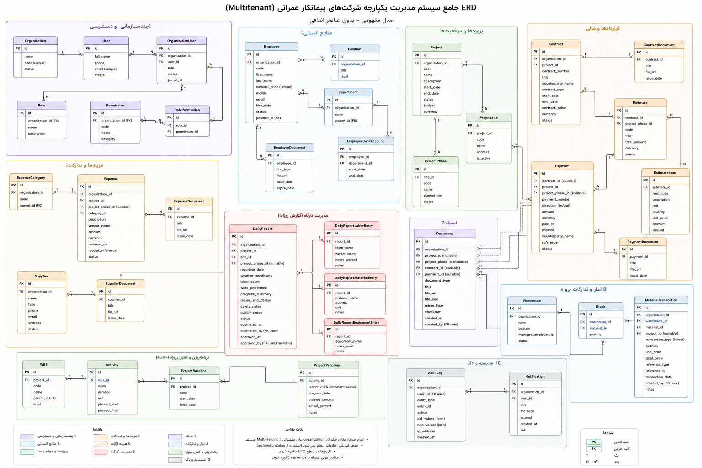

# Construction ERP — Project Snapshot

**Snapshot date:** 2026-09-15
**Status:** Active full-product development; the product is no longer scoped as
an MVP
**Architecture:** Multi-tenant Django modular monolith with PostgreSQL 18.6 and Psycopg 3

Construction ERP is being built as a complete, production-oriented SaaS product
for construction contractors. “Full product” defines the product scope and
quality target; it does not mean every roadmap capability is already implemented
or that production readiness has been certified. Delivery is incremental and
the status of each remaining capability is maintained in `ROADMAP.md`.

## Implemented capabilities

The application currently provides the following tenant-scoped modules:

- **Accounts:** custom user model and username/password authentication.
- **Organizations:** organization lifecycle, active membership selection,
  account provisioning and connection requests, configurable company roles,
  business permissions, organization settings, and active-tenant session handling.
- **Parties and materials:** reusable tenant-scoped counterparties, contacts,
  units of measure, material categories, and materials.
- **Projects:** projects, worksites, phases, soft archival, and role-limited
  project administration, plus WBS nodes and activities.
- **Workforce:** employees, departments, positions and dated position
  assignments, teams, project/site assignments, and private employee images.
- **Procurement:** purchase requests, permission-driven approval, supplier
  orders, and quantity-controlled goods receipts.
- **Inventory:** warehouses and an immutable movement ledger for receipts,
  issues, adjustments, transfers, reversals, and derived balances.
- **Equipment:** equipment masters, conflict-safe assignments, and maintenance
  history.
- **Daily reports:** daily worksite reporting with labor, equipment, material,
  progress, safety, and quality information.
- **Contracts:** organization-scoped project contracts and contract values.
- **Estimates:** estimate line items, Decimal totals, approvals, and locking of
  approved estimates.
- **Expenses:** recorded expenses, project/phase association, and an audited
  void workflow that preserves original financial values.
- **Payments:** posted receipts/disbursements, project/contract/phase links,
  void workflow, and financial reporting integration.
- **Documents:** validated private PDF/JPEG/PNG uploads, immutable versions,
  explicit links to supported business records, secure downloads, and archival.
- **Safety and quality:** standalone, permission-controlled incident and quality
  issue lifecycles with project and responsibility context.
- **Financials:** organization and project financial reporting using approved
  estimates, recorded expenses, and posted payments.
- **Audit:** append-only audit events for important security and business
  actions.

## Current architecture safeguards

- Business workflows are implemented in per-app `services.py` modules; views
  remain thin.
- Every business query and mutation is scoped to the authenticated user's active
  organization and active membership.
- Financial amounts use `Decimal`; business records use UUID identifiers.
- Finalized financial records are corrected through audited void workflows,
  rather than deletion or silent modification.
- Audit events reject application-layer changes, deletes, bulk inserts, and
  sensitive metadata keys.
- Suspended, archived, deleted, and cancelled organizations are denied at
  service boundaries.
- Payment and expense add/change/delete operations are unavailable in Django
  admin, preventing an administrative bypass of the audited workflows.

## UI status

- Django Templates and Tailwind CSS provide the product interface, with HTMX
  reserved for focused interactions that preserve server-side semantics.
- The ERP and Django Admin share a Persian-first, responsive RTL design system.
- Reusable page, form, feedback, navigation, table, and detail patterns support
  consistent implementation across current and future domains.
- Accessibility, technical-value direction, Jalali presentation, and financial
  formatting rules are defined in `docs/ui-guidelines.md`.

## Database baseline and migrations

PostgreSQL 18.6 is the authoritative database baseline. Django connects through
Psycopg 3; legacy database backends and drivers are not supported runtime
dependencies.

Apply all checked-in migrations to each configured PostgreSQL database before
use:

```powershell
.\.venv\Scripts\python.exe manage.py migrate
```

Migration files and Django models are the schema source of truth. Environments
must not assume their database is current; run `migrate` for each deployment.

No secrets or database credentials are stored in this repository. Local database
settings are read from `.env`; use `.env.example` as the safe template.

## Validation status

The latest documented PostgreSQL validation baseline is:

- `python manage.py check`
- `python -m ruff check .`
- `python -m ruff format --check .`
- Full PostgreSQL test suite: **167 passed**.
- Additional subtests: **26 passed**.

These figures are a recorded baseline, not the result of every later working-tree
change. Relevant checks must be rerun after implementation changes.

## Current local URL

The development login screen is available at:

`http://127.0.0.1:8011/accounts/login/`

Business pages require a logged-in user with an active organization. For example,
`/payments/` redirects to login until that context exists.

## Current full-product delivery priorities

- Implement Billing & Progress Claims as the next approved product-domain phase.
- Complete the remaining safety/quality extensions only through separately
  approved workflows.
- Continue tenant-isolation, object-authorization, lifecycle, and concurrency
  coverage for every new capability.
- Complete production deployment, PostgreSQL TLS, backup/restore, observability,
  retention/export, and browser workflow verification before certifying a
  production-ready release.

## Domain diagram

The diagram below represents the broader complete-product domain direction.
Some entities remain planned concepts and are not part of the current Django
schema; `docs/architecture/DOMAIN_AND_DATA_MODEL.md` identifies the current
implemented boundary.


