# Current Domain and Data Model

This document describes the currently implemented logical domains and data model, followed by the approved future product direction. It is an architectural guide, not a schema specification. Django models and migrations are the schema source of truth; application services define authorization, lifecycle transitions, and cross-model business rules.

## Model conventions and tenant boundary

- `User` is a global authenticated identity and may carry an optional unique Iranian national ID. Access to tenant data is granted through an active `OrganizationMembership` and the user's active organization; a user identifier or organization identifier supplied by a request is never sufficient authorization.
- `Organization` is the tenant root. Tenant-owned records carry an explicit `organization` foreign key, including child and history records, so querysets and service operations can be scoped directly.
- Services validate that every related object belongs to the same organization and also enforce structural relationships such as project -> site -> phase and project -> WBS node -> activity. Cross-organization foreign keys are forbidden.
- Business mutations require an active, non-deleted organization and an active membership whose role grants the required business permission. Read paths are also tenant-scoped. Important multi-step transitions are atomic and lock their primary aggregate row before rechecking state.
- Business records use UUID identifiers and timestamp mixins. Money and measured quantities use `Decimal`; financial calculations do not use binary floating point.
- Some legacy snapshot fields coexist with optional shared-master references. They remain part of the current schema and must not be removed without an approved, incremental schema change.

## Implemented domain boundaries

| Domain | Main entities | Current responsibility |
| --- | --- | --- |
| Accounts | `User` | Global authentication identity and effective active/inactive/blocked account state; `blocked_at` distinguishes an administrative block from ordinary inactivity. |
| Organizations | `Organization`, `OrganizationSettings`, `OrganizationMembership`, `OrganizationRole`, `BusinessPermission` | Tenant lifecycle and company identity/contact data; per-tenant logo, locale, fiscal-year, currency, and code-prefix settings; global administrator-defined company roles, code-owned business permissions, pending role assignment, and active-company access. Organization timezone/currency remain synchronized compatibility fields. |
| Parties | `BusinessParty`, `PartyRole`, `PartyContact` | Shared tenant counterparty master. A party may have employer, client, consultant, supplier, subcontractor, or other roles and tenant-scoped contacts. |
| Materials | `UnitOfMeasure`, `MaterialCategory`, `Material` | Tenant unit and material masters, including hierarchical categories and canonical material units. |
| Projects | `Project`, `ProjectSite`, `ProjectPhase`, `WBSNode`, `Activity` | Project/site/phase hierarchy and optional project-control structure. WBS nodes form a tree; each activity belongs to a WBS node and may reference a site, phase, and unit. |
| Workforce | `Employee`, `Department`, `Position`, `WorkTeam`, `EmployeeProjectAssignment` | Optional tenant personnel structure, employee lifecycle, teams, and project/site assignments. Personnel identity remains separate from an optional login user. |
| Procurement | `PurchaseRequest`, `PurchaseRequestItem`, `PurchaseOrder`, `PurchaseOrderItem`, `GoodsReceipt`, `GoodsReceiptItem` | Tenant purchasing from internal material request and approval through supplier order and quantity-controlled goods receipt. Receipts do not create inventory movements. |
| Inventory | `Warehouse`, `StockTransaction` | Tenant warehouse control through receipt, issue, adjustment, transfer, and reversal movements. On-hand quantity is derived from posted ledger entries rather than stored as an editable balance. |
| Equipment | `Equipment`, `EquipmentAssignment`, `MaintenanceRecord` | Tenant equipment master, conflict-safe project/site deployment history, and preserved service, repair, and inspection history. Current deployment is derived from assignments rather than stored on equipment. |
| Contracts | `Contract`, `ContractItem`, `ContractAmendment` | Receivable/payable commercial commitments, line items, controlled status changes, and immutable approved amendments. Optional party/direction/type references coexist with the legacy counterparty snapshot. |
| Estimates | `Estimate`, `EstimateRevision`, `EstimateItem` | Versioned estimates, Decimal line totals, approval, and preservation of approved history. The estimate points to its current revision; item text units coexist with optional shared units. |
| Daily reports | `DailyReport`, `DailyReportLaborEntry`, `DailyReportEquipmentEntry`, `DailyReportMaterialEntry`, `DailyActivity`, `DelayEvent` | Draft site reporting, structured labor/equipment/material/activity/delay details, and submit/approve workflow. Legacy descriptive snapshots remain alongside optional material, unit, and activity references. |
| Safety | `SafetyIncident` | Tenant/project-owned incident and near-miss records with optional site, phase, activity, daily-report, employee, user, and party context; controlled review, assignment, corrective-action, resolution, and closure lifecycle. |
| Expenses | `ExpenseCategory`, `Expense` | Tenant expense-category master and recorded operational costs. Optional party/category references coexist with legacy vendor/category snapshots. |
| Payments | `Payment`, `PaymentAllocation` | Posted receipts/disbursements and allocation of cash transactions to contracts. Voids and allocation reversals preserve history. |
| Documents | `ProjectDocument` | Immutable private project files, optionally linked to a payment, with validated metadata, audited access, and archival. |
| Audit | `AuditEvent` | Append-only evidence for important business and security actions. |
| Financials | No persisted model | Tenant-scoped read models that aggregate contracts, approved estimates, recorded expenses, and posted payments; this domain is not a second ledger. |

## Authorization model

- The global system administrator role (`admin`) is represented by Django superuser capability; the deployed primary account is named `admin`. A system administrator can administer every tenant, is the only actor allowed to create new organizations, and is the only actor allowed to create or change global company-role definitions. Organization-scoped roles cannot create another tenant.
- The protected built-in company roles are `company_owner`, `company_manager`, `operations_manager`, `member`, and `viewer`. The owner role is retained separately from company manager because ownership transfer and final-owner protection are lifecycle invariants, not ordinary permissions.
- `BusinessPermission` contains the code-owned capabilities that application services actually enforce. It is not generated automatically from database tables or generic CRUD operations. `OrganizationRole.permissions` composes those capabilities into built-in or administrator-defined roles.
- The system administrator creates an inactive user account and assigns it to one active organization as a membership in `pending_role` state, without choosing a role. An owner or authorized membership manager then selects an active global role; this atomically activates both the membership and the account. Organization users never browse the global user directory.
- Companies can assign active global roles within their own tenant, subject to owner protection and delegation limits. They cannot create role definitions or permission codes. A manager cannot assign or manage a role containing capabilities that the manager does not already hold.
- The legacy membership `role` code remains synchronized with `role_definition` for role-bearing memberships. A `pending_role` membership has neither until a company owner or manager completes provisioning. Authorization reads the role definition and its active permissions.
- Contract reads require the explicit `contracts.view` capability (or the stronger `contracts.manage` capability). Active organization membership alone does not expose contract data.

## Logical ERD

The diagram intentionally shows aggregates and important cross-domain links rather than ordinary audit, timestamp, and presentation fields. Every tenant-owned entity below also belongs directly to `Organization`, even where that repeated edge is omitted for readability.

```mermaid
erDiagram
    USER ||--o{ ORGANIZATION_MEMBERSHIP : has
    ORGANIZATION_ROLE ||--o{ ORGANIZATION_MEMBERSHIP : authorizes
    ORGANIZATION_ROLE }o--o{ BUSINESS_PERMISSION : grants
    ORGANIZATION ||--o| ORGANIZATION_SETTINGS : configures
    ORGANIZATION ||--o{ ORGANIZATION_MEMBERSHIP : grants

    ORGANIZATION ||--o{ BUSINESS_PARTY : owns
    BUSINESS_PARTY ||--o{ PARTY_ROLE : classifies
    BUSINESS_PARTY ||--o{ PARTY_CONTACT : has

    ORGANIZATION ||--o{ UNIT_OF_MEASURE : owns
    ORGANIZATION ||--o{ MATERIAL_CATEGORY : owns
    MATERIAL_CATEGORY o|--o{ MATERIAL_CATEGORY : parent_of
    MATERIAL_CATEGORY o|--o{ MATERIAL : groups
    UNIT_OF_MEASURE ||--o{ MATERIAL : measures

    ORGANIZATION ||--o{ PROJECT : owns
    PROJECT ||--o{ PROJECT_SITE : contains
    PROJECT_SITE ||--o{ PROJECT_PHASE : contains
    PROJECT ||--o{ WBS_NODE : plans
    WBS_NODE o|--o{ WBS_NODE : parent_of
    PROJECT ||--o{ ACTIVITY : schedules
    WBS_NODE ||--o{ ACTIVITY : groups
    PROJECT_SITE o|--o{ ACTIVITY : locates
    PROJECT_PHASE o|--o{ ACTIVITY : scopes
    UNIT_OF_MEASURE o|--o{ ACTIVITY : measures

    ORGANIZATION ||--o{ DEPARTMENT : owns
    DEPARTMENT o|--o{ DEPARTMENT : parent_of
    DEPARTMENT o|--o{ POSITION : defines
    DEPARTMENT o|--o{ WORK_TEAM : groups
    USER o|--o{ EMPLOYEE : authenticates
    POSITION o|--o{ EMPLOYEE : classifies
    WORK_TEAM o|--o{ EMPLOYEE : groups
    EMPLOYEE o|--o{ WORK_TEAM : leads
    EMPLOYEE ||--o{ EMPLOYEE_PROJECT_ASSIGNMENT : receives
    PROJECT ||--o{ EMPLOYEE_PROJECT_ASSIGNMENT : staffs
    PROJECT_SITE o|--o{ EMPLOYEE_PROJECT_ASSIGNMENT : locates

    PROJECT ||--o{ PURCHASE_REQUEST : requests
    PURCHASE_REQUEST ||--o{ PURCHASE_REQUEST_ITEM : contains
    MATERIAL ||--o{ PURCHASE_REQUEST_ITEM : identifies
    UNIT_OF_MEASURE ||--o{ PURCHASE_REQUEST_ITEM : measures
    PROJECT ||--o{ PURCHASE_ORDER : purchases
    PURCHASE_REQUEST o|--o{ PURCHASE_ORDER : authorizes
    BUSINESS_PARTY ||--o{ PURCHASE_ORDER : supplies
    PURCHASE_ORDER ||--o{ PURCHASE_ORDER_ITEM : contains
    PURCHASE_REQUEST_ITEM o|--o{ PURCHASE_ORDER_ITEM : sources
    MATERIAL ||--o{ PURCHASE_ORDER_ITEM : identifies
    UNIT_OF_MEASURE ||--o{ PURCHASE_ORDER_ITEM : measures
    PURCHASE_ORDER ||--o{ GOODS_RECEIPT : receives
    GOODS_RECEIPT ||--o{ GOODS_RECEIPT_ITEM : contains
    PURCHASE_ORDER_ITEM ||--o{ GOODS_RECEIPT_ITEM : fulfills
    MATERIAL ||--o{ GOODS_RECEIPT_ITEM : identifies
    UNIT_OF_MEASURE ||--o{ GOODS_RECEIPT_ITEM : measures

    ORGANIZATION ||--o{ WAREHOUSE : owns
    PROJECT o|--o{ WAREHOUSE : scopes
    WAREHOUSE o|--o{ STOCK_TRANSACTION : source
    WAREHOUSE o|--o{ STOCK_TRANSACTION : destination
    MATERIAL ||--o{ STOCK_TRANSACTION : moves
    UNIT_OF_MEASURE ||--o{ STOCK_TRANSACTION : measures
    PROJECT o|--o{ STOCK_TRANSACTION : consumes_for
    GOODS_RECEIPT_ITEM o|--o{ STOCK_TRANSACTION : sources
    STOCK_TRANSACTION o|--o| STOCK_TRANSACTION : reverses

    ORGANIZATION ||--o{ EQUIPMENT : owns
    EQUIPMENT ||--o{ EQUIPMENT_ASSIGNMENT : receives
    PROJECT ||--o{ EQUIPMENT_ASSIGNMENT : deploys
    PROJECT_SITE o|--o{ EQUIPMENT_ASSIGNMENT : locates
    EQUIPMENT ||--o{ MAINTENANCE_RECORD : maintains
    PROJECT o|--o{ MAINTENANCE_RECORD : scopes
    PROJECT_SITE o|--o{ MAINTENANCE_RECORD : locates
    BUSINESS_PARTY o|--o{ MAINTENANCE_RECORD : provides

    PROJECT ||--o{ CONTRACT : has
    BUSINESS_PARTY o|--o{ CONTRACT : counterparty
    CONTRACT ||--o{ CONTRACT_ITEM : contains
    CONTRACT ||--o{ CONTRACT_AMENDMENT : revises
    WBS_NODE o|--o{ CONTRACT_ITEM : codes
    UNIT_OF_MEASURE o|--o{ CONTRACT_ITEM : measures

    PROJECT ||--o{ ESTIMATE : has
    CONTRACT o|--o{ ESTIMATE : supports
    PROJECT_PHASE o|--o{ ESTIMATE : scopes
    ESTIMATE ||--o{ ESTIMATE_REVISION : versions
    ESTIMATE o|--o| ESTIMATE_REVISION : current_revision
    ESTIMATE ||--o{ ESTIMATE_ITEM : owns
    ESTIMATE_REVISION o|--o{ ESTIMATE_ITEM : contains
    UNIT_OF_MEASURE o|--o{ ESTIMATE_ITEM : measures

    PROJECT ||--o{ DAILY_REPORT : receives
    PROJECT_SITE ||--o{ DAILY_REPORT : records
    PROJECT_PHASE o|--o{ DAILY_REPORT : scopes
    DAILY_REPORT ||--o{ DAILY_REPORT_LABOR_ENTRY : contains
    DAILY_REPORT ||--o{ DAILY_REPORT_EQUIPMENT_ENTRY : contains
    DAILY_REPORT ||--o{ DAILY_REPORT_MATERIAL_ENTRY : contains
    MATERIAL o|--o{ DAILY_REPORT_MATERIAL_ENTRY : identifies
    UNIT_OF_MEASURE o|--o{ DAILY_REPORT_MATERIAL_ENTRY : measures
    DAILY_REPORT ||--o{ DAILY_ACTIVITY : contains
    ACTIVITY o|--o{ DAILY_ACTIVITY : references
    UNIT_OF_MEASURE o|--o{ DAILY_ACTIVITY : measures
    DAILY_REPORT ||--o{ DELAY_EVENT : contains
    ACTIVITY o|--o{ DELAY_EVENT : affects

    PROJECT ||--o{ SAFETY_INCIDENT : records
    PROJECT_SITE o|--o{ SAFETY_INCIDENT : locates
    PROJECT_PHASE o|--o{ SAFETY_INCIDENT : scopes
    ACTIVITY o|--o{ SAFETY_INCIDENT : relates
    DAILY_REPORT o|--o{ SAFETY_INCIDENT : originates
    EMPLOYEE o|--o{ SAFETY_INCIDENT : responsible_for
    BUSINESS_PARTY o|--o{ SAFETY_INCIDENT : responsible_for

    PROJECT ||--o{ QUALITY_ISSUE : records
    PROJECT_SITE o|--o{ QUALITY_ISSUE : locates
    PROJECT_PHASE o|--o{ QUALITY_ISSUE : scopes
    ACTIVITY o|--o{ QUALITY_ISSUE : relates
    DAILY_REPORT o|--o{ QUALITY_ISSUE : originates
    EMPLOYEE o|--o{ QUALITY_ISSUE : responsible_for
    BUSINESS_PARTY o|--o{ QUALITY_ISSUE : responsible_for

    ORGANIZATION ||--o{ EXPENSE_CATEGORY : owns
    PROJECT ||--o{ EXPENSE : incurs
    PROJECT_PHASE o|--o{ EXPENSE : scopes
    EXPENSE_CATEGORY o|--o{ EXPENSE : classifies
    BUSINESS_PARTY o|--o{ EXPENSE : vendor

    PROJECT ||--o{ PAYMENT : receives
    PROJECT_PHASE o|--o{ PAYMENT : scopes
    CONTRACT o|--o{ PAYMENT : references
    BUSINESS_PARTY o|--o{ PAYMENT : counterparty
    PAYMENT ||--o{ PAYMENT_ALLOCATION : allocates
    CONTRACT ||--o{ PAYMENT_ALLOCATION : receives

    PROJECT ||--o{ PROJECT_DOCUMENT : owns
    PAYMENT o|--o{ PROJECT_DOCUMENT : evidences
    ORGANIZATION o|--o{ AUDIT_EVENT : records
    USER o|--o{ AUDIT_EVENT : acts
```

## Key relationships and business invariants

- Organization creation and its initial owner membership are atomic. Membership is the authorization source of truth. System-admin provisioning creates a role-less pending membership; role assignment and account activation are tenant-authorized and atomic. Role and membership-status changes protect the final active owner and emit audit evidence. A settings row belongs to exactly one organization and is unique for it; the database relationship permits an organization to have no settings row during migration or recovery scenarios.
- Business permissions are stable capabilities implemented in application services, not automatically generated CRUD permissions for every table. Only the global system `admin` can compose, activate, deactivate, or remove unused global company roles. Companies may assign active roles but cannot define roles or permission codes. The protected company-owner role remains distinct from the company-manager role so ownership lifecycle rules do not depend on ordinary management access.
- Parties and master data are tenant-local. Archived parties, units, categories, materials, WBS nodes, and activities cannot be selected for new work. Category and WBS parent links must remain in the same tenant and hierarchy and cannot form cycles. Masters with active dependants cannot be archived where doing so would invalidate current references.
- A site belongs to one project and a phase to one site. Activity site/phase/WBS references must belong to the activity's project; a phase must belong to the selected site. A planned quantity requires an active unit and must be positive.
- Workforce structures are optional. An employee may link to at most one active organization-member user per tenant, but employee personnel data remains independent of authentication identity. Department hierarchies cannot cycle; department, position, team, employee, project, and optional site links must share a tenant, and assignment sites must belong to their project.
- Procurement requests, orders, receipts, their lines, projects, suppliers, materials, and units must share a tenant. Suppliers require an active supplier party role, material lines use the material's active canonical unit, ordered quantities linked to a request cannot exceed the requested quantity, and cumulative posted receipts cannot exceed an issued order line. Goods receipts record purchasing evidence and do not automatically create inventory movements.
- Request decisions, order issue/completion, and receipt posting/voiding are atomic and audited. Only draft documents accept line changes; approved requests, issued order terms, and posted receipt details are immutable. Voiding preserves receipt lines and reopens a completed order when its remaining posted receipts no longer fulfill it.
- Warehouses and stock transactions are tenant-owned; project-specific warehouses and movement projects must agree, and every movement uses the material's active canonical unit. A material cannot be archived while it has a draft movement or a nonzero derived warehouse balance, and a project cannot be archived before its project warehouses and draft movements are cleared. Receipt movements require a posted `GoodsReceiptItem`, exactly match its material, unit, project, and quantity, and must be reversed before the procurement receipt can be voided.
- Stock movements are `draft` until atomically posted. Posting locks participating warehouses, rejects insufficient source stock, and makes movement details immutable. Transfers debit one warehouse and credit another in one ledger record. Corrections create a reasoned, equal-and-opposite posted reversal while retaining the original movement; balances include both entries and are always derived from the ledger.
- Equipment, assignment, project, optional site, maintenance provider, and maintenance location must share a tenant; assignment sites and maintenance sites must belong to their selected project. Equipment does not store a current-project pointer. Non-cancelled assignment date ranges for one equipment cannot overlap; PostgreSQL enforces this invariant under concurrent writes. Final assignment and maintenance history cannot be deleted, and completed/cancelled records are immutable.
- Contract, estimate, expense, payment, daily-report, and document project/phase/site references must match both organization and project hierarchy. Optional party, material, unit, WBS, and activity references receive the same validation.
- Contract terms and items are editable only in `draft`. Once active or otherwise finalized, commercial change is represented by an amendment; approving an amendment does not silently overwrite the legacy contract header value.
- Versioned estimate items belong to a revision; the nullable revision link remains only for migration compatibility with legacy items. Approval locks the estimate aggregate, approves exactly one draft current revision, and supersedes any older approved revision. Creating a revision copies the approved current lines into a new draft; approved and superseded revisions are historical records.
- Daily-report details can be added only while the report is `draft`. Material units must match the selected material's canonical unit; structured quantities are positive, and progress is between 0 and 100.
- Safety incidents always belong to an organization and project. Optional site, phase, activity, and daily-report references must match that project hierarchy; responsible users must be active tenant members, and responsible employees/parties must be active tenant records. Every transition is permission-checked, atomic, row-locked, and audited; closed incidents cannot be edited or deleted through the model API.
- Expenses are created as `recorded` and payments as `posted`. Their financial details and original amounts are immutable. Corrections use a reasoned, audited void rather than edit/delete, and void records are excluded from financial reporting.
- A payment allocation must be positive and target a contract in the same organization and project. Under a payment-row lock, active allocations may not exceed the payment amount. Voiding a payment reverses, rather than deletes, its active allocations.
- Project documents are private and immutable file records. Uploads accept validated PDF/JPEG/PNG content up to 10 MB; payment links must match the document project. Downloads and archival are audited.
- Audit events cannot be updated, deleted, or bulk-created through the application model API. Audit metadata rejects sensitive credential-like keys.

## Key database constraints and identifiers

- Globally unique: organization `slug`, invitation `token_hash`, and user `username`.
- Organizations: one settings row per organization; one membership per `(user, organization)`.
- Parties: nonblank tax identifier unique per organization; party role unique per `(organization, party, role)`; contact value unique per `(organization, party, contact_type, value)`; at most one non-archived primary contact per party.
- Materials: unit code and symbol each unique per organization; material-category code and material code each unique per organization.
- Projects: project code unique per organization; site code unique per `(organization, project)`; phase code unique per `(organization, site)`; WBS and activity codes each unique per project.
- Contracts and estimates: contract number and estimate number each unique per organization; amendment number unique per contract; revision number unique per estimate.
- Operations and finance: one daily report per `(organization, site, reporting_date)`; expense-category code and payment number each unique per organization.
- Workforce: department, position, work-team, and employee numbers are unique per organization; a login user links to at most one employee per organization; duplicate active employee assignments to the same project or project site are prevented.
- Procurement: request, order, and goods-receipt numbers are each unique per organization; quantities are positive, order prices are non-negative, and an order line may appear at most once in a goods receipt.
- Inventory: warehouse code and stock-transaction number are each unique per organization; movement quantities are positive; source/destination shape is constrained by transaction type; and a goods-receipt item may have at most one draft or unreversed posted receipt movement.
- Equipment: equipment code, nonblank serial number, and maintenance record number are unique per organization; assignment date ranges for one equipment exclude overlap unless cancelled; and at most one maintenance record per equipment may be in progress.
- Safety: incident number is unique per organization; organization/project/status and organization/severity/status indexes support scoped operational review.
- Additional organization-first indexes support scoped lists and financial/reporting queries. Exact index definitions, foreign-key deletion behavior, lengths, precision, nullability, and defaults remain defined by migrations and models.

## Major lifecycle states

| Aggregate | States and implemented transitions |
| --- | --- |
| Organization | `active`, `suspended`, `cancelled`, `archived`; normal business mutation is allowed only while active and not soft-deleted. |
| Membership | `pending_role` -> `active`; an active membership may later become `suspended` or `revoked`. Assigning the first role activates the previously inactive account atomically. |
| Project / phase / activity | Project: `planning`, `active`, `on_hold`, `completed`, `cancelled`, plus soft archive. Phase: planning -> active/on hold; active -> on hold/completed; on hold -> active. Activity follows the same core flow and may also be cancelled from planning, active, or on hold. Completed/cancelled activities are terminal. |
| Contract / amendment | Contract: draft -> active/terminated; active -> completed/terminated. Amendment: draft -> approved; approved amendments are immutable. |
| Estimate / revision | Estimate: `draft`, `approved`, `revised`, `archived` compatibility states. Revision: draft -> approved; an older approval becomes superseded when a newer revision is approved. Revision creation returns the estimate aggregate to draft editing. |
| Daily report / delay | Report: draft -> submitted -> approved; submitted/approved content is locked. Delay event: `open` or `resolved` as stored operational state. |
| Expense | recorded -> void, with reason, actor, and timestamp; no restoration or destructive correction workflow. |
| Payment / allocation | Payment: posted -> void. Allocation: active -> reversed; payment void reverses all active allocations. |
| Document and masters | Documents and reusable masters use archival/deactivation rather than destructive deletion of business history. |
| Workforce | Employee: active -> inactive/terminated; inactive -> active/terminated; terminated is terminal. Assignment: active -> completed/cancelled; completed/cancelled are terminal. Workforce masters and employees use archival rather than deletion. |
| Procurement | Request: draft -> submitted -> approved/rejected, with draft/submitted cancellation. Order: draft -> issued -> completed, with draft/issued cancellation before receipt. Receipt: draft -> posted -> void; void preserves the posted evidence and may reopen its order. |
| Inventory | Warehouse: active -> archived only when it has no draft movement and every derived material balance is zero. Stock transaction: draft -> posted -> reversed; reversal creates an equal-and-opposite posted transaction and is terminal. |
| Equipment | Equipment: available -> inactive/retired and inactive -> available/retired; assignment and maintenance workflows manage assigned/maintenance operational states. Assignment: scheduled -> active/cancelled; active -> completed/cancelled. Maintenance: scheduled -> in progress/completed/cancelled; in progress -> completed/cancelled. Completed/cancelled history is terminal. |
| Safety incident | reported -> under review -> assigned -> corrective action in progress -> resolved -> closed. Assignment requires a responsible user, employee, or party; corrective action requires an action and due date; resolution and closure require summaries. Closed incidents are terminal and immutable. |
| Quality issue | reported -> under review -> assigned -> corrective action in progress -> awaiting verification -> verified -> closed. Assignment requires a responsible user, employee, or party and due date; verification and closure require recorded actors, timestamps, and summaries. Closed issues are terminal and immutable. |

## Workforce future integration

Time-entry and daily-labor integration remain deferred. Any future integration must preserve tenant scope and keep authenticated identity (`User`) distinct from personnel data (`Employee`).

## Equipment future integration

Daily-report equipment rows remain immutable descriptive snapshots and expenses remain general financial records; neither currently references the equipment master. Structured daily usage, fuel, and equipment-cost integration require separately approved workflows and must preserve existing historical rows.

## Deferred / Future Product Domains

The following approved target concepts are not implemented. Their presence here records product direction only and does not authorize schema or application changes.

| Future domain | Approved direction |
| --- | --- |
| Project control extensions | `CostCenter`, `ProjectBaseline`, and `ProgressRecord`, plus optional project/site access restrictions. Existing WBS nodes, activities, and daily progress observations do not replace these concepts. |
| Billing and progress claims | `ProgressClaim`, `ProgressClaimItem`, and `ClaimAdjustment`, including retention, tax, insurance, advance deductions, penalties, and other documented adjustments. |
| Documents v2 | Generalized `Document`, `DocumentVersion`, and `DocumentLink` with tenant-scoped access and preserved approved/history versions. Current `ProjectDocument` remains the implemented model. |
| Quality and safety extensions | Inspection, risk, formal CAPA, and generalized document-link workflows remain optional future concepts. Current daily-report notes remain lightweight observations; `SafetyIncident` and `QualityIssue` are implemented standalone workflows. |
| Notifications | A tenant-aware, user-facing `Notification` model for relevant system and workflow events. Audit events remain immutable evidence and are not notifications. |

Optional enterprise structures must not be required for small contractors. Each future domain needs separately approved workflow, ownership, lifecycle, permissions, and an incremental migration plan before implementation.

Full general-ledger accounting, payroll, CRM, generic workflow engines, microservices, and event sourcing remain outside the approved product model. DRF APIs and background-job infrastructure are deferred technical capabilities rather than implemented domains.
