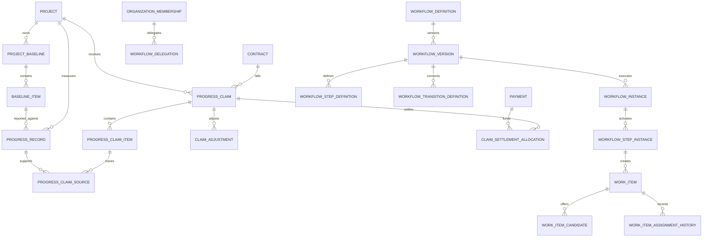

# Current Domain and Data Model

This document describes the currently implemented logical domains and data model, followed by the approved future product direction. It is an architectural guide, not a schema specification. Django models and migrations are the schema source of truth; application services define authorization, lifecycle transitions, and cross-model business rules.

Construction ERP is designed and governed as a complete construction-management
product rather than an MVP. The tables below deliberately distinguish the
implemented model from deferred product direction: complete-product scope does
not make an unimplemented entity part of the current schema and does not bypass
the approval sequence in `ROADMAP.md`.

The repository-wide current/target capability assessment, data-ownership map,
pre-production correction register, and production gates are maintained in
`docs/architecture/PRODUCT_CAPABILITY_AND_READINESS_AUDIT.md`. This document
stays intentionally focused on implemented domain boundaries and invariants.
The target domain boundaries and conceptual data/source-of-truth rules are in
`DOMAIN_MODEL.md` and `DATA_MODEL.md`; they do not override current schema.

## Model conventions and tenant boundary

- `User` is a global authenticated identity and may carry an optional unique Iranian national ID. Access to tenant data is granted through an active `OrganizationMembership` and the user's active organization; a user identifier or organization identifier supplied by a request is never sufficient authorization.
- `Organization` is the tenant root. Tenant-owned records carry an explicit `organization` foreign key, including child and history records, so querysets and service operations can be scoped directly.
- Services validate that every related object belongs to the same organization and also enforce structural relationships such as project -> site -> phase and project -> WBS node -> activity. Cross-organization foreign keys are forbidden.
- Ordinary business mutations require an active, non-deleted organization and an active membership whose currently implemented single role grants the required business permission. Read paths are also tenant-scoped. Important multi-step transitions are atomic and lock their primary aggregate row before rechecking state. This is current behavior, not the target multi-role policy described below.
- Business records use UUID identifiers and timestamp mixins. Money and measured quantities use `Decimal`; financial calculations do not use binary floating point.
- Some legacy snapshot fields coexist with optional shared-master references. They remain part of the current schema and must not be removed without an approved, incremental schema change.

## Implemented domain boundaries

| Domain | Main entities | Current responsibility |
| --- | --- | --- |
| Accounts | `User` | Global authentication identity and effective active/inactive/blocked account state; `blocked_at` distinguishes an administrative block from ordinary inactivity. |
| Organizations | `Organization`, `OrganizationSettings`, `OrganizationMembership`, `OrganizationRole`, `BusinessPermission`, `PolicySource`, `PlatformPolicy`, `PlatformPolicyVersion`, `TenantPolicySelection`, `PolicyReviewEvidence` | Tenant lifecycle and company identity/contact data; `OrganizationSettings` is authoritative for direct per-Tenant logo, locale, timezone, fiscal-year, currency and code-prefix settings. Platform Admin owns versioned policy/localization structures and Platform-owned values, Tenant Owner approves important selections, and Tenant Admin applies selections and maintains authorized operational values. Each policy explicitly states whether source provenance is required. Optional professional evidence is metadata, not a role. Global roles, code-owned permissions, membership-scoped assignments and active-company access enforce the boundary. Legacy `Organization.timezone`/`currency` remain inert compatibility fields until a separately authorized contract stage. |
| Parties | `BusinessParty`, `PartyIdentitySnapshot`, `PartyAlias`, `PartyClassification`, `PartyClassificationAssignment`, `PartyRepresentative`, `PartyRestriction`, `PartyRole`, `PartyContact` | Shared Tenant counterparty master with deterministic match keys, append-only identity/alias evidence, non-destructive direct merge lineage, historical category/tag assignments, effective representative/signatory evidence and generic effective-dated Tenant/Platform restrictions. Product Owner-accepted P9-S12–S15 adds one optional partner-profile extension for qualification/performance, exact DMS evidence and explainable evaluation without a transaction consumer. Duplicate matching never merges automatically; merge preserves source records and historical foreign keys. Tenant services cannot weaken Platform restrictions, and no regulated meaning or transaction consumer is activated. Representative evidence is not a `User` or permission grant. |
| Materials | `UnitOfMeasure`, `UnitFamily`, `UnitConversionVersion`, `QuantityRoundingPolicyVersion`, `QuantityConversionSnapshot`, `MaterialCategory`, `Material`, `MaterialAlias`, `MaterialDuplicateCandidate`, `MaterialSupersession`, `MaterialAttributeDefinition`/version/value/import, `MaterialPriceObservation`, `MaterialRelationship`, `MaterialTechnicalApproval`, `MaterialDocumentLink` | Tenant unit/material masters with canonical aliases and non-destructive supersession. Convertible units have one Tenant family base and immutable effective factors to it; legacy units are isolated until a steward configures them. Attributes use closed Platform types/operators and Tenant category/version authority; price observations preserve source/currency/unit but are not purchase quotes or ledger facts. Material relationships are Tenant-local and immutable; technical approvals retain version/scope decision evidence and an approved replacement supersedes rather than changes prior history. Material links pin the governed document version. |
| Projects | `Project`, `ProjectSite`, `ProjectPhase`, `WBSNode`, `Activity` | Project/site/phase hierarchy and optional project-control structure. WBS nodes form a tree; each activity belongs to a WBS node and may reference a site, phase, and unit. |
| Workforce | `Employee`, `Department`, `Position`, `WorkTeam`, `EmployeePositionAssignment`, `EmployeeProjectAssignment`, `Skill`, `Competency`, immutable employee-skill/qualification/training/performance evidence and `LaborRateVersion` | Optional tenant personnel structure, dated multi-position history with one primary position, teams, project/site assignments, private tenant-scoped employee image, and bounded P7 capability/evidence history. Personnel identity remains separate from an optional login user; performance and labor rates are sensitive, default-denied Workforce facts with no downstream financial effect. |
| Timekeeping | `WorkCalendar`, `CalendarHoliday`, `ShiftDefinition`, `ShiftBreak`, `AttendanceRecord`, immutable import/correction/reconciliation evidence, `LeaveMissionRequest`, `OvertimeRequest`, `Timesheet`, `TimesheetEntry`, immutable review and `LaborDistributionPreview` | Tenant-timezone operational evidence with project/site scope, maker-checker transitions and immutable finalized/submitted history. Attendance records presence; timesheets allocate approved time and never rewrite attendance. Preview lines conserve minutes and have no Payroll, Project Cost or financial effect. |
| Procurement | Request/RFQ/quote/comparison/award models; `PurchaseOrder` plus immutable versions/changes; `GoodsReceipt`; `ServiceAcceptance`; AP-owned `SupplierInvoice` and immutable match/tolerance evidence | Tenant-scoped internal source-to-pay evidence through match classification. Receipt/service/invoice/match evidence creates no Inventory, payable, GL, cost, Treasury or cash fact. |
| Inventory | `Warehouse`, `StockTransaction`, custody/traceability/reservation/count/transfer records, `InventoryValuationEvent`, `InventoryValuationPool`, `InventoryValuationException`, `DownstreamCostSourceEnvelope` | Tenant warehouse quantity/custody and moving-WAC valuation-evidence authority through accepted P8-S17. On-hand remains derived from posted/reversed movements. Downstream envelopes remain proposals; all financial consumers remain separate. |
| Equipment | `Equipment`, operational P8 models, `EquipmentCostPolicyVersion`, `EquipmentCostRate`, `EquipmentCostAllocation`, `EquipmentCostSourceEnvelope` | Tenant operational authority plus versioned internal-rate and conserved allocation proposals. The legacy maintenance `cost` remains descriptive; allocations/envelopes are neither actuals nor journals and cannot mutate Inventory. |
| Fixed Assets | `FixedAssetClassVersion`, `AssetBookPolicyVersion`, `FixedAsset`, effective Equipment/source links, `AssetTransaction`, `DepreciationRun`/`DepreciationLine`, handoff/reconciliation envelopes | Distinct tenant financial-asset evidence authority: source-backed capitalization, one historical-cost straight-line book, transfer/impairment/disposal and explicit reversal. Accounting and Project Controls remain sole journal/actual authorities. |
| Contracts | `Contract`, `ContractItem`, `ContractAmendment`, `ContractTermVersion` | Receivable/payable commercial commitments, stable line identities, controlled status changes, immutable approved amendments and independently approved effective commercial terms. Optional party/direction/type references coexist with the legacy counterparty snapshot. |
| Estimates | `Estimate`, `EstimateRevision`, `EstimateItem` | Versioned estimates, Decimal line totals, approval, and preservation of approved history. The estimate points to its current revision; item text units coexist with optional shared units. |
| Daily reports | `DailyReport`, `DailyReportLaborEntry`, `DailyReportEquipmentEntry`, `DailyReportMaterialEntry`, `DailyActivity`, `DelayEvent` | Draft site reporting, structured labor/equipment/material/activity/delay details, and submit/approve workflow. Legacy descriptive snapshots remain alongside optional material, unit, and activity references. |
| Safety | `SafetyIncident` | Tenant/project-owned incident and near-miss records with optional site, phase, activity, daily-report, employee, user, and party context; controlled review, assignment, corrective-action, resolution, and closure lifecycle. |
| Quality | `QualityIssue` | Tenant/project-owned non-conformity and quality issue records with optional site, phase, activity, daily-report, employee, user, and party context; controlled review, assignment, corrective-action, verification, and closure lifecycle. |
| HSE/QA Controls | `InspectionTemplate`, immutable `InspectionTemplateVersion`, typed `Inspection`, `Permit`, `QualityTest`, immutable `TestResult`, `InspectionFinding`, QA `Nonconformance`, `CapaAction`, `ComplianceEvidenceLink`, lifecycle event and downstream proposal | Product Owner-accepted P9-S06–S11 shared mechanics with mandatory HSE/QA profiles, project/site scope, separate business authority, exact DMS-version/hash evidence, narrow person-level verification separation, immutable finalized history and proposal-only downstream boundary. |
| Expenses | `PlatformExpenseGroup`, `ExpenseCategory`, `Expense` | Platform-owned canonical expense groups; tenant-owned expense categories linked to one active group; and recorded operational costs. Group codes preserve the legacy expense-category snapshot values while platform changes are audited and tenant categories remain organization-scoped. Optional party/category references coexist with legacy vendor/category snapshots. |
| Payments | `Payment`, `PaymentAllocation` | Posted receipts/disbursements and allocation of cash transactions to contracts. Voids and allocation reversals preserve history. |
| Field Operations | `FieldObservation`, immutable `FieldObservationDraftRevision` and `FieldObservationTransition`, `FieldObservationEvidenceLink`, `FieldDownstreamProposal` and its transition history | P9-S01–S05 owns tenant/project-scoped field observation context, optional minimized device location, review state and correction/replacement lineage. DMS alone owns document/media bytes and immutable versions; this domain pins an exact DMS version/hash. A reviewed proposal remains source-only and cannot create accounting, cost, inventory, equipment, payroll, contract, procurement, billing, AP/AR or treasury facts. |
| AP/AR subledgers | `Obligation`, `SettlementAllocation`, `SettlementReversal`, `WriteOffProposal`, `AgingRun`, `SubledgerReconciliationRun`, `SubledgerReconciliationReview` | Immutable Tenant obligations and exact lineage, capped Treasury-linked settlement/reversal, per-item as-of aging, retained reconciliation exceptions and independent signed review. Source/Accounting adapters and write-off approval/reversal remain fail-closed pending explicit policy. |
| Documents | `Document`, `DocumentVersion`, domain-owned typed document links, `DocumentProcessingAssessment`, signature evidence, retention policy/application, legal hold, disposal intent, export/recovery manifests | Versioned protected documents with immutable Tenant numbering, closed confidentiality, expiry, complete-context RBAC, fail-closed scan availability, PostgreSQL permission-scoped search, non-destructive retention/hold/export governance and separated recovery evidence. Legacy `DocumentLink` remains a dual-written migration/rollback projection. |
| Audit | `AuditEvent` | Append-only evidence for important business and security actions. |
| Knowledge | `KnowledgeCandidate`/immutable revision, `KnowledgePublication`/immutable version and lifecycle event, typed source/DMS pins, `KnowledgePromotion` history, `KnowledgeRecurrenceEvidence` and immutable `KnowledgeReuseEvidence` | Product Owner-accepted P9-S21–S24 bounded runtime owns only reviewed derivatives and immutable publication/recurrence/reuse evidence. Source domains retain facts; DMS retains bytes/versions; Tenant and Platform ownership are separate, promotion freezes a sanitized derivative, and cross-Tenant source disclosure is prohibited. Focused PostgreSQL acceptance and rollback/reapply pass. |
| Financials | No persisted model | Tenant-scoped read models that aggregate contracts, approved estimates, recorded expenses, and posted payments; this domain is not a second ledger. |
| Billing | Receivable `ProjectBaseline`, `ProgressRecord`, `ProgressClaim` and settlement evidence; payable `PayableMeasurement`, `PayableCertificate`, line and adjustment evidence; `ContractGuarantee`, `ContractComplianceEvidence`, `RetentionRelease`, `TaxpayerInvoice`, `ContractorComplianceAssessment` and statutory submission/resolution evidence; Contracts owns `ContractTermVersion`; Organizations owns regulatory selection | Receivable claims and payable certificates remain distinct authorities. P6-S01–S32 pins Tenant/project/contract/party/currency/term/policy/calculation/document evidence; preserves linked correction/cancellation/renewal/release and submission-attempt history; adds expiry, separated exposure, schema preflight, idempotent retry and reconciliation; and limits retention release to explicit approved terms and retained balances. AR/AP handoffs remain explicit and Accounting identities non-operational. |
| Workflow and work management | `WorkflowType`, `WorkflowTemplate`, `WorkflowDefinition`, `WorkflowVersion`, `WorkflowStepDefinition`, `WorkflowTransitionDefinition`, `WorkflowCondition`, `WorkflowRoutingRule`, `WorkflowInstance`, `WorkflowStepInstance`, `WorkItem`, `WorkItemCandidate`, `WorkItemAssignmentHistory`, `WorkflowDelegation` | Code-backed platform catalog; tenant-scoped immutable published graphs; runtime execution; candidate/assignment/delegation history; persistent work items and centralized workbench. Adopted domains invoke registered services and keep their invariants authoritative. |

## Implemented cross-domain workflow boundary (F5 complete)

F5 provides tenant-owned, versioned workflow definitions and the code-backed
catalog, registry, validation, publication, simulation, runtime instances,
position- and membership-aware routing, persistent work items, candidate pools,
assignment history, delegation, centralized workbench, permission, and audit
boundaries. The delivered model, migration slices, and acceptance evidence are
defined in
`docs/architecture/TENANT_WORKFLOW_AND_WORK_MANAGEMENT.md`.

Until each domain is explicitly migrated, its current application services, permissions,
states, and audit behavior remain authoritative. The workflow foundation will
coordinate registered domain commands; it will not replace domain lifecycle or
financial/operational invariants with generic state.

The bounded workflow platform is tenant-configurable but code-constrained.
Tenants may compose published platform step, condition, routing, and decision
types; they may not run arbitrary Python, SQL, templates, network calls, or
unvalidated expressions. Small-tenant templates must work without workforce
structures, while larger tenants may opt into position routing, candidate pools,
multi-stage approval, delegation, fallback, and separation-of-duties controls.

Billing and workflow runtime relationships added after the original core ERD are
summarized here. Domain services enforce the tenant/project and lifecycle
invariants that an ERD cannot express:

## Authorization model

- The deployed primary account named `admin` currently has Django superuser capability. This is a current **Superuser** compatibility path, not evidence that the distinct target **Platform Admin** role exists. Current code lets this path administer every Tenant, create organizations and manage global company-role definitions. Under Q04-E1, Superuser remains exceptional technical/system authority and receives no target ordinary Tenant business-data access without a separate explicit, scoped, authorized and audited mechanism.
- Target **Platform Admin** owns permitted operational platform administration, Tenant provisioning and global configuration. Platform Admin and Superuser are independent assignments; the same user may explicitly hold both, while neither implies the other. Implementing that distinction requires a separately approved package.
- The protected built-in Tenant role codes are `company_owner`, `company_manager`, `operations_manager`, `member`, and `viewer`. These current codes do not yet constitute the complete canonical target vocabulary. **Tenant Owner**, **Tenant Admin / Local Admin** and **Tenant Manager** remain independent target roles; Tenant Owner does not imply Tenant Admin, Tenant Manager is business/operational rather than administrative, and explicit multi-role assignment is allowed without implicit inheritance.
- The implemented `OrganizationMembership.role_definition` is a single foreign key and current membership services replace that role when it changes. Current runtime therefore supports one Tenant role per membership; it does **not** yet implement the authoritative target multi-role policy. The target is a Tenant-preserving many-to-many relation such as `User -> OrganizationMembership -> MembershipRoleAssignment -> OrganizationRole`, with zero-to-many independent role assignments per membership. The same User may have different role sets in different Tenants.
- Target role combinations remain separate assignments: for example Tenant Owner, Tenant Admin and Project Manager may coexist on one Membership without a composite role. Assigning or revoking one assignment must not assign, replace or revoke another. Each assignment/revocation retains actor, Tenant, role, timestamp and relevant reason/context.
- `BusinessPermission` contains the code-owned capabilities that application services actually enforce. It is not generated automatically from database tables or generic CRUD operations. `OrganizationRole.permissions` composes those capabilities into built-in or administrator-defined roles.
- Under the target model, authorization unions business permissions from all active applicable Membership role assignments and then intersects that result with active Membership, explicit Grants, effective Project/Site Scope, Delegation, Workflow eligibility and applicable policy constraints. Role union alone never supplies unrestricted scope or a missing authorization factor.
- Every new access-controlled capability must introduce its permission atomically across `BusinessPermissionCode`, the permission registry, a data migration that creates the catalog entry and assigns appropriate default roles, and server-side checks in both its view and service boundary. UI visibility is only a presentation concern; it never substitutes for authorization. Permission and tenant-isolation tests are required for the new capability.
- The current Superuser provisioning path creates an inactive user account and assigns it to one active organization as a membership in `pending_role` state, without choosing a role. Target provisioning belongs to an explicitly authorized Platform Admin capability, distinct from Superuser. A Tenant actor holding the explicit membership-management permission currently selects one active Tenant role; this atomically activates both the membership and account. A separately approved target implementation must allow later independent role assignments without replacing existing assignments. In the target vocabulary that capability may be assigned independently to a Tenant Owner, Tenant Admin or another authorized user, but no role label supplies it implicitly. Tenant users never browse the global user directory.
- Authorized Tenant actors can manage Tenant role assignments within their own Tenant, subject to Tenant Owner protection and delegation limits. They cannot create global role definitions or permission codes. Tenant Admin and Tenant Manager remain distinct: business management alone does not confer membership/role administration, and no actor may assign capabilities outside delegated authority. The target service changes one assignment at a time and audits the actor, Tenant, role, timestamp and reason/context.
- A Tenant actor with the explicit account-management permission may create Tenant accounts with a temporary password. In the target role model this authority may be assigned independently to a Tenant Owner, Tenant Admin or another authorized user; neither Tenant role provides it by title alone. Such accounts are authenticated identities with `must_change_password` enabled and middleware blocks all application access except password initialization and logout until the user chooses a personal password. Plaintext passwords are never stored.
- An existing global identity is never attached directly by a Tenant actor. An actor with the explicit account-management permission submits an exact-username connection request without browsing the global user directory, and only the target identity can accept it after authentication. Employee/account links remain optional, tenant-scoped, independently permission-checked, and audited when linked or unlinked.
- The legacy membership `role` code remains synchronized with the single current `role_definition` for role-bearing memberships. A `pending_role` membership has neither until a Tenant actor with the explicit membership-management permission completes provisioning. Current authorization reads that one role definition and its active permissions. A future multi-role implementation requires an approved expand -> backfill -> switch -> validate -> separately approved compatibility-field contraction; this documentation does not prescribe or authorize that schema change.
- Contract reads require the explicit `contracts.view` capability (or the stronger `contracts.manage` capability). Active organization membership alone does not expose contract data.

## Logical ERD

The diagram intentionally shows aggregates and important cross-domain links rather than ordinary audit, timestamp, and presentation fields. Every tenant-owned entity below also belongs directly to `Organization`, even where that repeated edge is omitted for readability.

```mermaid
erDiagram
    USER ||--o{ ORGANIZATION_MEMBERSHIP : has
    ORGANIZATION_ROLE ||--o{ ORGANIZATION_MEMBERSHIP : current_single_role
    ORGANIZATION_ROLE }o--o{ BUSINESS_PERMISSION : grants
    ORGANIZATION ||--o| ORGANIZATION_SETTINGS : configures
    ORGANIZATION ||--o{ ORGANIZATION_MEMBERSHIP : grants

    ORGANIZATION ||--o{ BUSINESS_PARTY : owns
    BUSINESS_PARTY ||--o{ PARTY_ROLE : classifies
    BUSINESS_PARTY ||--o{ PARTY_CONTACT : has

    ORGANIZATION ||--o{ UNIT_OF_MEASURE : owns
    ORGANIZATION ||--o{ MATERIAL_CATEGORY : owns
    MATERIAL_CATEGORY o|--o{ MATERIAL_CATEGORY : parent_of
    MATERIAL_CATEGORY o|--o{ MATERIAL : groups
    UNIT_OF_MEASURE ||--o{ MATERIAL : measures

    ORGANIZATION ||--o{ PROJECT : owns
    PROJECT ||--o{ PROJECT_SITE : contains
    PROJECT_SITE ||--o{ PROJECT_PHASE : contains
    PROJECT ||--o{ WBS_NODE : plans
    WBS_NODE o|--o{ WBS_NODE : parent_of
    PROJECT ||--o{ ACTIVITY : schedules
    WBS_NODE ||--o{ ACTIVITY : groups
    PROJECT_SITE o|--o{ ACTIVITY : locates
    PROJECT_PHASE o|--o{ ACTIVITY : scopes
    UNIT_OF_MEASURE o|--o{ ACTIVITY : measures

    ORGANIZATION ||--o{ DEPARTMENT : owns
    DEPARTMENT o|--o{ DEPARTMENT : parent_of
    DEPARTMENT o|--o{ POSITION : defines
    DEPARTMENT o|--o{ WORK_TEAM : groups
    USER o|--o{ EMPLOYEE : authenticates
    POSITION o|--o{ EMPLOYEE : classifies
    WORK_TEAM o|--o{ EMPLOYEE : groups
    EMPLOYEE o|--o{ WORK_TEAM : leads
    EMPLOYEE ||--o{ EMPLOYEE_PROJECT_ASSIGNMENT : receives
    EMPLOYEE ||--o{ EMPLOYEE_POSITION_ASSIGNMENT : holds
    POSITION ||--o{ EMPLOYEE_POSITION_ASSIGNMENT : assigned_as
    PROJECT ||--o{ EMPLOYEE_PROJECT_ASSIGNMENT : staffs
    PROJECT_SITE o|--o{ EMPLOYEE_PROJECT_ASSIGNMENT : locates

    PROJECT ||--o{ PURCHASE_REQUEST : requests
    PURCHASE_REQUEST ||--o{ PURCHASE_REQUEST_ITEM : contains
    MATERIAL ||--o{ PURCHASE_REQUEST_ITEM : identifies
    UNIT_OF_MEASURE ||--o{ PURCHASE_REQUEST_ITEM : measures
    PROJECT ||--o{ PURCHASE_ORDER : purchases
    PURCHASE_REQUEST o|--o{ PURCHASE_ORDER : authorizes
    BUSINESS_PARTY ||--o{ PURCHASE_ORDER : supplies
    PURCHASE_ORDER ||--o{ PURCHASE_ORDER_ITEM : contains
    PURCHASE_REQUEST_ITEM o|--o{ PURCHASE_ORDER_ITEM : sources
    MATERIAL ||--o{ PURCHASE_ORDER_ITEM : identifies
    UNIT_OF_MEASURE ||--o{ PURCHASE_ORDER_ITEM : measures
    PURCHASE_ORDER ||--o{ GOODS_RECEIPT : receives
    GOODS_RECEIPT ||--o{ GOODS_RECEIPT_ITEM : contains
    PURCHASE_ORDER_ITEM ||--o{ GOODS_RECEIPT_ITEM : fulfills
    MATERIAL ||--o{ GOODS_RECEIPT_ITEM : identifies
    UNIT_OF_MEASURE ||--o{ GOODS_RECEIPT_ITEM : measures

    ORGANIZATION ||--o{ WAREHOUSE : owns
    PROJECT o|--o{ WAREHOUSE : scopes
    WAREHOUSE o|--o{ STOCK_TRANSACTION : source
    WAREHOUSE o|--o{ STOCK_TRANSACTION : destination
    MATERIAL ||--o{ STOCK_TRANSACTION : moves
    UNIT_OF_MEASURE ||--o{ STOCK_TRANSACTION : measures
    PROJECT o|--o{ STOCK_TRANSACTION : consumes_for
    GOODS_RECEIPT_ITEM o|--o{ STOCK_TRANSACTION : sources
    STOCK_TRANSACTION o|--o| STOCK_TRANSACTION : reverses

    ORGANIZATION ||--o{ EQUIPMENT : owns
    EQUIPMENT ||--o{ EQUIPMENT_ASSIGNMENT : receives
    PROJECT ||--o{ EQUIPMENT_ASSIGNMENT : deploys
    PROJECT_SITE o|--o{ EQUIPMENT_ASSIGNMENT : locates
    EQUIPMENT ||--o{ MAINTENANCE_RECORD : maintains
    PROJECT o|--o{ MAINTENANCE_RECORD : scopes
    PROJECT_SITE o|--o{ MAINTENANCE_RECORD : locates
    BUSINESS_PARTY o|--o{ MAINTENANCE_RECORD : provides

    PROJECT ||--o{ CONTRACT : has
    BUSINESS_PARTY o|--o{ CONTRACT : counterparty
    CONTRACT ||--o{ CONTRACT_ITEM : contains
    CONTRACT ||--o{ CONTRACT_AMENDMENT : revises
    WBS_NODE o|--o{ CONTRACT_ITEM : codes
    UNIT_OF_MEASURE o|--o{ CONTRACT_ITEM : measures

    PROJECT ||--o{ ESTIMATE : has
    CONTRACT o|--o{ ESTIMATE : supports
    PROJECT_PHASE o|--o{ ESTIMATE : scopes
    ESTIMATE ||--o{ ESTIMATE_REVISION : versions
    ESTIMATE o|--o| ESTIMATE_REVISION : current_revision
    ESTIMATE ||--o{ ESTIMATE_ITEM : owns
    ESTIMATE_REVISION o|--o{ ESTIMATE_ITEM : contains
    UNIT_OF_MEASURE o|--o{ ESTIMATE_ITEM : measures

    PROJECT ||--o{ DAILY_REPORT : receives
    PROJECT_SITE ||--o{ DAILY_REPORT : records
    PROJECT_PHASE o|--o{ DAILY_REPORT : scopes
    DAILY_REPORT ||--o{ DAILY_REPORT_LABOR_ENTRY : contains
    DAILY_REPORT ||--o{ DAILY_REPORT_EQUIPMENT_ENTRY : contains
    DAILY_REPORT ||--o{ DAILY_REPORT_MATERIAL_ENTRY : contains
    MATERIAL o|--o{ DAILY_REPORT_MATERIAL_ENTRY : identifies
    UNIT_OF_MEASURE o|--o{ DAILY_REPORT_MATERIAL_ENTRY : measures
    DAILY_REPORT ||--o{ DAILY_ACTIVITY : contains
    ACTIVITY o|--o{ DAILY_ACTIVITY : references
    UNIT_OF_MEASURE o|--o{ DAILY_ACTIVITY : measures
    DAILY_REPORT ||--o{ DELAY_EVENT : contains
    ACTIVITY o|--o{ DELAY_EVENT : affects

    PROJECT ||--o{ SAFETY_INCIDENT : records
    PROJECT_SITE o|--o{ SAFETY_INCIDENT : locates
    PROJECT_PHASE o|--o{ SAFETY_INCIDENT : scopes
    ACTIVITY o|--o{ SAFETY_INCIDENT : relates
    DAILY_REPORT o|--o{ SAFETY_INCIDENT : originates
    EMPLOYEE o|--o{ SAFETY_INCIDENT : responsible_for
    BUSINESS_PARTY o|--o{ SAFETY_INCIDENT : responsible_for

    PROJECT ||--o{ QUALITY_ISSUE : records
    PROJECT_SITE o|--o{ QUALITY_ISSUE : locates
    PROJECT_PHASE o|--o{ QUALITY_ISSUE : scopes
    ACTIVITY o|--o{ QUALITY_ISSUE : relates
    DAILY_REPORT o|--o{ QUALITY_ISSUE : originates
    EMPLOYEE o|--o{ QUALITY_ISSUE : responsible_for
    BUSINESS_PARTY o|--o{ QUALITY_ISSUE : responsible_for

    ORGANIZATION ||--o{ EXPENSE_CATEGORY : owns
    PROJECT ||--o{ EXPENSE : incurs
    PROJECT_PHASE o|--o{ EXPENSE : scopes
    EXPENSE_CATEGORY o|--o{ EXPENSE : classifies
    BUSINESS_PARTY o|--o{ EXPENSE : vendor

    PROJECT ||--o{ PAYMENT : receives
    PROJECT_PHASE o|--o{ PAYMENT : scopes
    CONTRACT o|--o{ PAYMENT : references
    BUSINESS_PARTY o|--o{ PAYMENT : counterparty
    PAYMENT ||--o{ PAYMENT_ALLOCATION : allocates
    CONTRACT ||--o{ PAYMENT_ALLOCATION : receives

    PROJECT ||--o{ PROJECT_DOCUMENT : owns
    PAYMENT o|--o{ PROJECT_DOCUMENT : evidences
    ORGANIZATION o|--o{ AUDIT_EVENT : records
    USER o|--o{ AUDIT_EVENT : acts
```

## Key relationships and business invariants

- Organization creation and its initial Tenant Owner membership are atomic. Membership is the Tenant-context authorization source of truth. The current Superuser provisioning path creates a role-less pending membership; target provisioning belongs to Platform Admin authority. Current account activation assigns one role; the target permits multiple independent membership-scoped assignments and preserves each assignment/revocation as audit evidence. Role and membership-status changes protect the final active Tenant Owner. A settings row belongs to exactly one organization and is unique for it; the database relationship permits an organization to have no settings row during migration or recovery scenarios.
- Business permissions are stable capabilities implemented in application services, not automatically generated CRUD permissions for every table. Current code reserves global company-role definition management to the `admin` Superuser path; target global operational administration belongs to explicit Platform Admin authority, while Protected Operations remain Superuser-controlled. Tenants may assign active roles but cannot define global roles or permission codes. Tenant Owner, Tenant Admin and Tenant Manager must remain independent so ownership, administration and business management do not imply one another.
- Parties and master data are tenant-local. Archived parties, units, categories, materials, WBS nodes, and activities cannot be selected for new work. Category and WBS parent links must remain in the same tenant and hierarchy and cannot form cycles. Masters with active dependants cannot be archived where doing so would invalidate current references.
- A site belongs to one project and a phase to one site. Activity site/phase/WBS references must belong to the activity's project; a phase must belong to the selected site. A planned quantity requires an active unit and must be positive.
- Workforce structures are optional. An employee may link to at most one active organization-member user per tenant, but employee personnel data remains independent of authentication identity. Employees may hold multiple dated active positions with at most one primary position; a single-holder position such as CEO permits only one active holder. Department hierarchies cannot cycle; department, position, team, employee, project, and optional site links must share a tenant, and assignment sites must belong to their project. Job positions never grant system permissions by themselves.
- P7-S01–S05 Workforce records are tenant scoped. Employee skill and labor-rate
  intervals cannot overlap for the same scoped subject/component; their history,
  qualifications, training and performance evidence are append-only. Qualification
  expiry is derived and revocation/supersession is retained. DMS evidence is a
  typed, version-pinned link. Performance and labor-rate facts are explicitly
  granted only, and create no time, payroll, project-cost, AP, accounting,
  Treasury or cash fact.
- P7-S06–S12 Timekeeping records are Tenant scoped and optionally project/site
  scoped. Calendar timezone must equal authoritative `OrganizationSettings`;
  cross-midnight shifts and each break interval are explicit. Final attendance,
  request decisions, submitted timesheets, reviews, corrections and previews
  retain append-only evidence. Policy-dependent approvals require an explicit
  approved-policy reference; no entitlement, multiplier, rounding or pay value is
  inferred. Minute-only previews never post or create a cost/obligation.
- An employee profile image is optional, private, and organization-owned. It is preferred for workforce display; the linked user's global profile image is only a display fallback and is never copied or synchronized automatically.
- Procurement requests, sourcing evidence, immutable PO/change versions, receipts/service acceptances, and their projects, suppliers, materials and units must share a Tenant. Suppliers require an active supplier party role. Award consumption is explicit, PO changes are append-only and independently approved, and cumulative receipt/service quantities cannot exceed the governing version or S11 allocation. AP-owned invoice versions and match evidence retain exact PO/acceptance lineage; neither goods/service acceptance nor match automatically creates Inventory, payable, GL, cost, Treasury or cash facts.
- Request decisions, order issue/completion, and receipt posting/voiding are atomic and audited. Only draft documents accept line changes; approved requests, issued order terms, and posted receipt details are immutable. Voiding preserves receipt lines and reopens a completed order when its remaining posted receipts no longer fulfill it.
- Until the F5 migration, Procurement uses the active membership's `BusinessPermission` for each action, with one request approval decision rather than separately routed technical or financial approvals. It does not resolve approvers from workforce hierarchy, job position, department, work team, or project-assignment data, and it has no amount thresholds, delegation, or mandatory separation-of-duties policy. A member holding both the relevant create/submit and approve permissions may approve their own request; every transition remains auditable. The compatibility workflow introduced by F5 must preserve this behavior before a tenant explicitly publishes a stronger policy.
- Warehouses and stock transactions are tenant-owned; project-specific warehouses and movement projects must agree, and every movement uses the material's active canonical unit. A material cannot be archived while it has a draft movement or a nonzero derived warehouse balance, and a project cannot be archived before its project warehouses and draft movements are cleared. Receipt movements require a posted `GoodsReceiptItem`, exactly match its material, unit, project, and quantity, and must be reversed before the procurement receipt can be voided.
- Stock movements are `draft` until atomically posted. Posting locks participating warehouses, rejects insufficient source stock, and makes movement details immutable. Transfers debit one warehouse and credit another in one ledger record. Corrections create a reasoned, equal-and-opposite posted reversal while retaining the original movement; balances include both entries and are always derived from the ledger.
- Equipment, assignment, project, optional site, maintenance provider, and maintenance location must share a tenant; assignment sites and maintenance sites must belong to their selected project. Equipment does not store a current-project pointer. Non-cancelled assignment date ranges for one equipment cannot overlap; PostgreSQL enforces this invariant under concurrent writes. Final assignment and maintenance history cannot be deleted, and completed/cancelled records are immutable.
- P8-S05–S11 extends only Inventory quantity/custody evidence. Procurement
  acceptance, Inventory movement, operational maintenance, future Fixed Asset
  transactions, Accounting journals and Project Cost facts remain distinct
  authorities. P7 Payroll financial handoffs remain proposals and cannot be
  consumed as actuals.
- Contract, estimate, expense, payment, daily-report, and document project/phase/site references must match both organization and project hierarchy. Optional party, material, unit, WBS, and activity references receive the same validation.
- Contract terms and items are editable only in `draft`. Once active or otherwise finalized, commercial change is represented by an amendment; approving an amendment does not silently overwrite the legacy contract header value.
- Versioned estimate items belong to a revision; the nullable revision link remains only for migration compatibility with legacy items. Approval locks the estimate aggregate, approves exactly one draft current revision, and supersedes any older approved revision. Creating a revision copies the approved current lines into a new draft; approved and superseded revisions are historical records. P4-S01–S06 adds tenant/project-scoped draft resource composition and recorded assumptions plus immutable price/rate provenance; they remain planning evidence and cannot calculate a rate/coefficient, create a budget baseline, or mutate a financial domain until their explicit Product Owner gates resolve.
- P4-S07–S13 adds a Project Controls planning authority: a budget version pins the current approved Estimate revision and a complete line manifest; each included amount is conserved across version-pinned leaf CBS, active project WBS and explicitly applicable cost center mappings. Submitted payloads are hashed; accepted versions and locked cost structures are database-immutable. One project control pointer selects the governing accepted version. This does not create a commitment, actual, forecast, journal or cash fact, and it does not replace legacy Project totals.
- P4-S14–S20 adds an expand-only Project Controls projection: independently approved producer-source contracts precede append-only commitment, accrual and actual facts; exact source/event/occurrence/classification lineage, reversal/replacement, coverage watermarks and immutable draft forecasts support permission-scoped drill-through. No operational producer is connected, no GL/source authority is mutated and legacy Project totals remain unchanged.
- P4-S21–S25 adds draft schedule revisions, milestones and cycle-safe dependency evidence; immutable constraint/issue/risk/delay observations with append-only open/closed/reopen history; and immutable change/rebaseline proposals. Responsibility is fixed to `undetermined`, contractual impact to `unassessed`, and change financial effect to `observation_only`. Baseline/change/rebaseline acceptance, risk scoring, EOT/entitlement, earned value and scheduler integration fail closed.
- P6-S33–S38 adds Contracts-owned `ContractualRecord` and append-only
  `ContractualRecordEvidence` for Site Instructions, Variation/Change Orders,
  contractual Claims and EOT. Approved entitlement, amount, delay responsibility
  and EOT days are explicit reviewer facts. Source evidence remains owned by DMS,
  Billing, schedules and Project Controls; neither side is silently mutated.
- Daily-report details can be added only while the report is `draft`. Material units must match the selected material's canonical unit; structured quantities are positive, and progress is between 0 and 100. When a conversion is explicitly used, it must select same-family effective factor versions and a required effective rounding policy, preserving an immutable snapshot.
- A field observation is tenant and project scoped; optional site, phase and activity must match the Project hierarchy. Location is optional, consent/permission-labelled, accuracy/time-labelled and untrusted; no location is fabricated or treated as authoritative. A draft may change through revision snapshots; submitted content and exact DMS evidence links are immutable. Independent review accepts or rejects with append-only history, and a correction creates a successor without overwriting the original. A submitted or reviewed observation cannot receive a new DMS attachment. Reviewed downstream proposals are source-only and never mutate a consuming domain.
- Safety incidents always belong to an organization and project. Optional site, phase, activity, and daily-report references must match that project hierarchy; responsible users must be active tenant members, and responsible employees/parties must be active tenant records. Every transition is permission-checked, atomic, row-locked, and audited; closed incidents cannot be edited or deleted through the model API.
- Legacy expenses remain immutable `recorded -> void` history. P4-S26–S30 adds new `draft -> submitted -> approved/returned -> void` operational evidence with direct maker/checker, retained source fingerprints, idempotency, explicit conserved Project/WBS/optional Activity/CBS/CostCenter splits, manual recurrence proposals and immutable advisory accepted-budget snapshots. Approved expense evidence does not itself create a payable, journal, cash movement, Project Cost fact or settlement. Payments remain `posted`; corrections use reasoned audited void rather than destructive edit/delete, and void expenses remain excluded from financial reporting.
- P4-S31–S34 reads, but does not mutate, a governing accepted budget and identically pinned approved/recorded expense allocations for a project-scoped comparison. Its separately permissioned CSV excludes raw source identifiers and records an append-only audit manifest; advisory overrun evidence remains neither a warning nor a transaction control.
- P4-S35–S37 hardens exact expense retry payloads, same-budget assessment and coded-dimension Project Cost reversal/relief conservation under deterministic PostgreSQL locks. Its separately permissioned/audited reconciliation remains a non-persistent read model: accepted budget, approved/recorded expense and inert Project Cost evidence stay distinct; missing evidence is unknown, Project Cost facts without a budget-version key are uncomparable, coverage is incomplete and differences remain unresolved. No producer, ledger, settlement, budget or policy authority is created.
- A payment allocation must be positive and target a contract in the same organization and project. Under a payment-row lock, active allocations may not exceed the payment amount. Voiding a payment reverses, rather than deletes, its active allocations.
- Documents use immutable Tenant-sequenced numbers, descriptive categories, closed confidentiality levels and access expiry. Each protected immutable `DocumentVersion` is durable on receipt but unavailable until the latest append-only processing assessment is clean. Domain-owned typed Project/Contract/Estimate/Expense/Payment/DailyReport links preserve legacy UUID lineage behind a closed registry; every retained context governs access and missing parity denies. PostgreSQL search applies the same authority and indexes only clean extracted text. Retention policy versions and applications, legal holds, non-destructive disposal intents, export manifests, byte-category accounting and reconciled recovery/key evidence preserve history and separation. Unknown duration/content fails closed; no destructive disposal, production provider/scanner, legal signature standard, numeric RPO/RTO or quota value is activated.
- Audit events cannot be updated, deleted, or bulk-created through the application model API. Audit metadata rejects sensitive credential-like keys.

## Key database constraints and identifiers

- Globally unique: organization `slug`, invitation `token_hash`, and user `username`.
- Organizations: one settings row per organization; one membership per `(user, organization)`.
- Parties: nonblank tax identifier unique per organization; party role unique per `(organization, party, role)`; contact value unique per `(organization, party, contact_type, value)`; at most one non-archived primary contact per party.
- Materials: unit code and symbol each unique per organization; unit-family code and material-category/material code each unique per organization. Conversion version is unique per unit; rounding policy version is unique per `(organization, code, version)`.
- Projects: project code unique per organization; site code unique per `(organization, project)`; phase code unique per `(organization, site)`; WBS and activity codes each unique per project.
- Contracts and estimates: contract number and estimate number each unique per organization; amendment number unique per contract; revision number unique per estimate.
- Operations and finance: one daily report per `(organization, site, reporting_date)`; expense-category code and payment number each unique per organization. `PlatformExpenseGroup` code and name are globally unique, and each tenant expense category references one protected group. Document references are unique when nonblank per organization, version numbers are unique per document, and every document link contains exactly one supported target and is unique for that document/target pair.
- Workforce: department, position, work-team, and employee numbers are unique per organization; a login user links to at most one employee per organization; duplicate active employee/position pairs, multiple active primary positions, and duplicate active project/site assignments are prevented. Single-holder positions are serialized and checked at the service boundary.
- Procurement: request, order, and goods-receipt numbers are each unique per organization; quantities are positive, order prices are non-negative, and an order line may appear at most once in a goods receipt.
- Inventory: warehouse code and stock-transaction number are each unique per organization; movement quantities are positive; source/destination shape is constrained by transaction type; and a goods-receipt item may have at most one draft or unreversed posted receipt movement.
- Equipment: equipment code, nonblank serial number, and maintenance record number are unique per organization; assignment date ranges for one equipment exclude overlap unless cancelled; and at most one maintenance record per equipment may be in progress.
- Safety: incident number is unique per organization; organization/project/status and organization/severity/status indexes support scoped operational review.
- Additional organization-first indexes support scoped lists and financial/reporting queries. Exact index definitions, foreign-key deletion behavior, lengths, precision, nullability, and defaults remain defined by migrations and models.

## Major lifecycle states

| Aggregate | States and implemented transitions |
| --- | --- |
| Organization | `active`, `suspended`, `cancelled`, `archived`; normal business mutation is allowed only while active and not soft-deleted. |
| Membership | `pending_role` -> `active`; an active membership may later become `suspended` or `revoked`. Assigning the first role activates the previously inactive account atomically. |
| Account connection request | `pending` -> `accepted` or `rejected`; only the exact authenticated target user may perform the terminal transition. Acceptance atomically creates the tenant membership. |
| Project / phase / activity | Project: `planning`, `active`, `on_hold`, `completed`, `cancelled`, plus soft archive. Phase: planning -> active/on hold; active -> on hold/completed; on hold -> active. Activity follows the same core flow and may also be cancelled from planning, active, or on hold. Completed/cancelled activities are terminal. |
| Contract / amendment | Contract: draft -> active/terminated; active -> completed/terminated. Amendment: draft -> approved; approved amendments are immutable. |
| Estimate / revision | Estimate: `draft`, `approved`, `revised`, `archived` compatibility states. Revision: draft -> approved; an older approval becomes superseded when a newer revision is approved. Revision creation returns the estimate aggregate to draft editing. |
| Daily report / delay | Report: draft -> submitted -> approved; submitted/approved content is locked. Delay event: `open` or `resolved` as stored operational state. |
| Expense | Legacy: recorded -> void. New: draft -> submitted -> approved or returned; returned -> submitted; any non-void state -> void with reason, actor and timestamp. Maker/submitting actor cannot approve; no restoration or destructive correction. |
| Payment / allocation | Payment: posted -> void. Allocation: active -> reversed; payment void reverses all active allocations. |
| Document and masters | Documents use archival; versions, typed links, processing/signature evidence and retention applications are append-only. Holds retain release evidence; disposal stops at reviewed non-destructive intent and unknown duration/active hold blocks it. The legacy link projection is retained for migration/rollback and never releases access. Reusable masters use archival/deactivation. |
| Workforce | Employee: active -> inactive/terminated; inactive -> active/terminated; terminated is terminal. Position assignment: active -> ended, preserving dates and the responsible assignment record. Project assignment: active -> completed/cancelled; completed/cancelled are terminal. Workforce masters and employees use archival rather than deletion. |
| Timekeeping | Attendance: draft/exception -> finalized -> superseded/reversed only through reasoned independent adjustment. Leave/mission/overtime: draft -> submitted -> approved/rejected, with independent reviewer and policy reference for approval. Timesheet: draft -> submitted -> approved/rejected; correction creates a linked higher revision and supersedes history. Distribution preview is immutable and non-posting. |
| Procurement | Request: draft -> submitted -> approved/rejected. Order: draft -> issued -> completed/cancelled; issue freezes version 1 and approved change evidence creates immutable successor versions. Receipt: draft -> posted -> void. Service acceptance: draft -> accepted -> void. Supplier invoice: draft -> submitted -> independently approved/rejected, with correction by successor version. Match policy requires independent approval; each match run is immutable and classifies matched/within-tolerance/blocked/incomplete without downstream release. |
| Inventory | Warehouse: active -> archived only when it has no draft movement and every derived material balance is zero. Stock transaction: draft -> posted -> reversed; reversal creates an equal-and-opposite posted transaction with copied trace lineage. Reservation: draft -> active -> partially fulfilled/fulfilled or reasoned cancelled/expired. Count: draft -> frozen -> counted -> submitted -> independently approved -> linked adjustments posted. Custody transfer: draft -> dispatched -> in-transit -> independently accepted with explicit exception disposition. |
| Equipment | Equipment: available -> inactive/retired and inactive -> available/retired; assignment and maintenance workflows manage assigned/maintenance operational states. Assignment: scheduled -> active/cancelled; active -> completed/cancelled. Maintenance: scheduled -> in progress/completed/cancelled; in progress -> completed/cancelled. Completed/cancelled history is terminal. |
| Equipment cost / Fixed Assets | Cost and book/class policies: draft -> reviewed -> published. Allocation: prepared -> finalized -> explicitly reversed. Asset: draft candidate -> ready for review -> active/capitalized, with transfer/impairment/disposal through linked immutable transactions. Depreciation: preview -> finalized -> explicit reversing run. Handoffs remain prepared/reviewed/reconciled proposals only. |
| Safety incident | reported -> under review -> assigned -> corrective action in progress -> resolved -> closed. Assignment requires a responsible user, employee, or party; corrective action requires an action and due date; resolution and closure require summaries. Closed incidents are terminal and immutable. |
| Quality issue | reported -> under review -> assigned -> corrective action in progress -> awaiting verification -> verified -> closed. Assignment requires a responsible user, employee, or party and due date; verification and closure require recorded actors, timestamps, and summaries. Closed issues are terminal and immutable. |

## Workforce workflow integration target

P7-S06–S12 time entry is implemented without daily-report, Payroll or Project
Cost integration. Any later integration must preserve tenant scope and keep
authenticated identity (`User`) distinct from personnel data (`Employee`). A
workflow that requires an organizational position must require both the actor's
ordinary business permission and an effective `EmployeePositionAssignment`; the
workflow decision should retain the qualifying assignment identifier so later
position changes do not rewrite historical authority.

The approved F5 workflow foundation applies this rule to position-based routing.
One active `OrganizationMembership` receives one centralized workbench per active
organization even when its linked employee holds multiple positions; work items
may be filtered by position but are deduplicated by actionable responsibility.
Position assignment routes work and records the actor's qualifying capacity; it
never becomes a second authorization system.

## Equipment future integration

Daily-report equipment rows remain immutable descriptive snapshots and expenses remain general financial records; neither currently references the equipment master. Structured daily usage, fuel, and equipment-cost integration require separately approved workflows and must preserve existing historical rows.

Accepted P8-S01–S23 assigns operational identity, deployment,
meter/fuel/downtime and maintenance execution to Equipment; warehouse/bin custody
and spare-part issue/return to Inventory; and keeps all links reference-only across
those authorities. The accepted S24–S27 implementation assigns Equipment cost-rate/allocation
proposals to Equipment; capitalization, carrying value, depreciation, impairment,
transfer and disposal to a distinct Fixed Assets authority; journals to
Accounting; and classified actuals to Project Controls through separately accepted
consumer contracts. Accepted P8-C01–C38=A, expand-only migration, the exact runtime
boundary and implementation evidence are in `P8_S24_S27_EQUIPMENT_COST_AND_FIXED_ASSETS_DECISION_PACKET.md`.

## Approved remaining product domains

The following rows describe remaining target scope. Delivered partial foundations
are stated explicitly; target concepts do not authorize additional schema or
application changes.

| Future domain | Approved direction |
| --- | --- |
| Identity, tenant commercial controls, and object scope | MFA, optional SSO, subscription/feature entitlements, quotas, export/offboarding, time-limited support access, and explicit project/site authorization intersecting tenant permissions. |
| Accounting, Treasury and AP/AR | Accounting has the native kernel and remains sole journal authority. Treasury through retained bank reconciliation is implemented. AP/AR now has immutable obligations, capped Treasury settlement/reversal, exact as-of aging and retained reconciliation foundations, while source/posting activation, write-off authority, bucket policy and UI remain gated. Controlled exports, scheduling/proposals, thresholds, provider adapters, review/sign-off and pilot activation remain target scope. Existing `Payment` and legacy financial read models are not a ledger. |
| Regulatory configuration | Effective-dated tax, payroll, social-insurance, invoice-schema, calendar and rounding policy/configuration with RBAC, history, applied-version snapshots and policy-specific provenance requirements. Contract commercial terms remain separately versioned. |
| Project control and costing | Versioned CBS/cost centers, accepted budgets, cost projections, draft schedule revisions/items/dependencies, evidence registers, and change/rebaseline proposals are implemented. Real producer activation, accepted forecast/schedule/change/rebaseline governance, risk scoring, contractual impact and broader KPI projections remain gated. `ProjectBaseline` and `ProgressRecord` remain the distinct Billing measurement baseline. |
| Billing and commercial extensions | Contracts-owned contractual change/Claim/EOT evidence is delivered without automatic effects. Automatic contract/amendment, budget/schedule baseline, AP/AR/journal production, downstream financial correction reversal, official e-invoice/provider integration and Article 38 interpretation/effects remain gated. |
| Source-to-pay | RFQ, quote comparison, sourcing award, supplier invoice, two/three-way match, commitment, AP, payment proposal, and supplier-performance evidence. |
| Attendance, payroll, and employee insurance | P7-S01–S36 is Product Owner accepted and complete within its documented non-production boundary. Immutable, idempotent liability, Accounting-source, payment and Project Cost proposals retain correction/reversal/replacement lineage and evidence-only reconciliation. Final assurance separates sensitive audit and handoff-family access, preserves version-pinned history and adds no export beyond explicitly permitted audited paths. Official values/schemas, legal retention periods, live filing, downstream recognition/execution, P8 behavior and production activation remain gated. |
| Inventory, equipment, and fixed assets | P8-S01–S30 is Product Owner accepted and complete within documented non-production boundaries. P8-C01–C38=A governs accepted Equipment cost proposals and distinct Fixed Assets capitalization/depreciation/disposal evidence; Inventory valuation, Accounting journals and Project Cost actuals remain separate. |
| Quality and safety extensions | Product Owner-accepted P9-S06–S11 provides typed inspections, source-backed permits, governed QA tests/results, explicit NCR, CAPA, verification/closure, exact DMS evidence and assurance. Risk, toolbox/PPE, broader ITP/sample approval/punch/rework, notifications/escalation delivery and knowledge remain future; `SafetyIncident` and `QualityIssue` stay separate authoritative workflows. |
| Notifications | Product Owner-accepted P9-S16–S20 provides Tenant/recipient-scoped, source-linked in-app attention with exact deduplication. S25 adds registered-source/active-recipient creation and open-time source revalidation with a non-leaking unavailable state. Audit events remain immutable evidence and are not notifications; external delivery remains deferred. |
| Knowledge, partner performance, support, and AI | Product Owner-accepted P9-S12–S25 runtime provides Tenant-local partner qualification/evaluation, bounded support/access and reviewed derivative Knowledge with exact source/DMS provenance, reproducible recurrence, immutable reuse/correction and restricted Platform promotion. S25 cross-domain assurance is accepted. Each domain remains separately governed; cited assistive AI is deferred and cannot publish. |
| Controlled business network | Explicit opt-in discovery/recommendation and verified shared claims only after tenant-local governance and privacy controls are mature; private tenant transactions and evaluations never become shared by default. |

Optional enterprise structures must not be required for small contractors. Each future domain needs separately approved workflow, ownership, lifecycle, permissions, and an incremental migration plan before implementation.

General-purpose CRM, unbounded BPM/BPMN, tenant-authored executable code,
microservices, event sourcing, and BIM authoring remain outside the approved
product model unless a separately evidenced decision changes that boundary.
General-ledger Accounting and Treasury foundations, non-posting Core Payroll and
the P7-S23–S28 fail-closed statutory tax/employee-insurance framework are
implemented within their recorded boundaries. Official Iranian activation, live
filing, Payroll financial consumers, activated Project Costing and Fixed Assets
remain approved target domains but unimplemented.
DRF APIs and background-job infrastructure are deferred technical capabilities;
they should be introduced only for approved consumers and concrete asynchronous
workloads.
