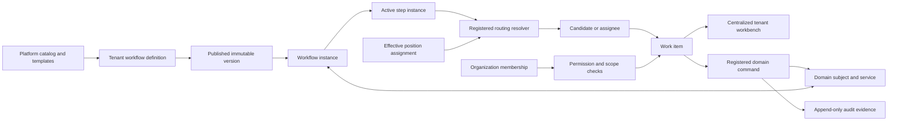

# Tenant Workflow & Work Management Architecture

> Status: **APPROVED TARGET ARCHITECTURE — NOT YET IMPLEMENTED**  
> Approved: 2026-09-15  
> Delivery phase: `F5 — Tenant Workflow & Work Management` in `ROADMAP.md`

## 1. Purpose

Construction ERP must support tenants ranging from two- or three-person
contractors to large companies with departments, positions, project teams,
delegation, and formal approval controls. A single fixed approval path cannot
serve that range without either blocking small tenants or under-controlling
large ones.

This document defines the target architecture and executable scope for:

- tenant-owned workflow configuration based on safe platform capabilities;
- versioned workflow definitions and runtime instances;
- position-, role-, team-, project-, and membership-aware routing;
- centralized work items, candidate pools, claiming, reassignment, and
  delegation;
- a single tenant workbench for every active organization membership;
- incremental migration of existing domain workflows without rewriting their
  authoritative business lifecycles.

The architecture is intentionally a **bounded business-workflow platform**, not
an arbitrary BPM/BPMN runtime. Tenants configure approved building blocks; they
cannot execute custom Python, SQL, templates, network calls, or unvalidated
expressions.

## 2. Architectural decision

Workflow configuration is tenant-owned. The platform owns the catalog of
supported workflow types, step types, conditions, routing target types, domain
commands, and starter templates. An organization owner, or another active
membership with explicit workflow-management permissions, may create, validate,
publish, retire, and supersede versions for that organization.

The following responsibilities remain separate:

| Concern | Source of truth |
| --- | --- |
| Authentication identity | `User` |
| Tenant access and broad authorization | `OrganizationMembership` and `BusinessPermission` |
| Personnel and current organizational position | `Employee` and effective `EmployeePositionAssignment` |
| Domain lifecycle and financial/operational invariants | The owning domain model and application service |
| Workflow definition and routing policy | Published tenant `WorkflowVersion` |
| Current workflow execution | `WorkflowInstance` and `WorkflowStepInstance` |
| Actionable responsibility and workbench state | `WorkItem`, candidates, assignment, and delegation records |
| Immutable evidence | Domain history plus `AuditEvent` |

A position may route responsibility, but never grants a system permission by
itself. The final actor is always an active `OrganizationMembership`; a
position-routed action also retains the effective position-assignment identifier
that qualified the actor.



## 3. Core principles

1. **Domain services remain authoritative.** Workflow execution calls a
   registered domain command; it does not mutate domain status fields directly.
2. **Tenant isolation is structural.** Every tenant configuration and runtime
   record carries `organization`; all relations and lookups are checked against
   it.
3. **Published versions are immutable.** Editing creates a new draft version.
   Existing instances stay pinned to their starting version unless an explicit,
   audited migration is performed.
4. **Routing and authorization are cumulative.** Being a candidate or assignee
   is not permission; holding permission is not assignment.
5. **Small-company operation requires no workforce hierarchy.** Every platform
   starter template has an owner- or membership-based fallback.
6. **Enterprise controls are opt-in but enforceable.** Multi-stage approvals,
   amount conditions, parallel decisions, delegation, and separation of duties
   are available only when explicitly configured.
7. **No critical behavior in signals.** Domain mutation, workflow advancement,
   work-item completion, and audit evidence are coordinated explicitly in an
   application service and transaction.
8. **History is preserved.** Reconfiguration, reassignment, delegation, and
   corrections append evidence rather than rewrite prior decisions.
9. **Deterministic execution.** The same inputs, pinned version, and effective
   tenant state produce the same eligible transition and an auditable routing
   result.
10. **Incremental adoption.** Existing workflows remain operational until their
    domain is migrated and validated.

## 4. Product model

### 4.1 Platform-owned catalog

The system administrator manages code-backed catalogs and starter templates:

- workflow type, such as `procurement.purchase_request_approval`;
- supported domain events and commands;
- allowed step types and decision policies;
- supported condition and routing resolver types;
- required business-permission codes;
- graph and domain-specific validation rules;
- starter templates suitable for small, medium, and controlled organizations.

Catalog entries are deployed with code and data migrations. A tenant cannot add
an executable catalog type.

### 4.2 Tenant-owned definitions

A `WorkflowDefinition` identifies one tenant's workflow for a stable workflow
type and optional scope. A definition owns immutable, numbered
`WorkflowVersion` records. Draft versions contain normalized step, transition,
condition, routing, deadline, escalation, and decision-policy configuration.

Supported scopes, applied from most specific to least specific, are:

1. project/site-specific configuration where the workflow type permits it;
2. supported business classification or amount band;
3. organization default;
4. platform starter fallback.

Resolution must select exactly one published version. Ambiguous matches prevent
publication or execution; they are never resolved by database ordering.

### 4.3 Runtime instances

A `WorkflowInstance` is created for a registered domain subject and pinned to
one published version. It contains runtime state only; the subject's domain
model remains the authoritative source of business state.

Each activated `WorkflowStepInstance` may create one or more `WorkItem` records.
A work item identifies the requested action, candidate set, current assignee or
claimant, due time, priority, routing basis, and completion outcome.

The centralized workbench reads persisted work items. It does not rediscover
pending work by scattering status queries across every domain.

## 5. Proposed persisted concepts

Exact Django fields and app ownership require an implementation design review,
but the approved conceptual model is:

| Concept | Responsibility |
| --- | --- |
| `WorkflowType` | Code-backed registry metadata for one supported domain process |
| `WorkflowTemplate` | Platform-owned starter configuration |
| `WorkflowDefinition` | Tenant-owned logical workflow and scope |
| `WorkflowVersion` | Immutable-on-publication numbered definition |
| `WorkflowStepDefinition` | Typed step, decision policy, deadline, and required permission |
| `WorkflowTransitionDefinition` | Valid edge and outcome between steps |
| `WorkflowCondition` | Typed and schema-validated condition values |
| `WorkflowRoutingRule` | Ordered target resolver and fallback chain |
| `WorkflowInstance` | Pinned execution for one tenant-owned domain subject |
| `WorkflowStepInstance` | Runtime state and outcome of one definition step |
| `WorkItem` | Action requested from a person or candidate pool |
| `WorkItemCandidate` | Snapshot of an eligible tenant membership and routing basis |
| `WorkItemAssignmentHistory` | Append-only claim, release, assign, reassign, and completion history |
| `WorkflowDelegation` | Date-bounded delegation within one organization and permitted scope |

Runtime records use UUID identifiers and timestamps. Tenant-owned uniqueness and
indexes must begin with `organization` where appropriate. Work-item overdue state
is derived from an open state and `due_at`; time passing alone does not rewrite
history.

### 5.1 Domain subject reference

Cross-domain subjects use a stable, code-backed subject type and UUID public
identifier, resolved through a registered adapter. Arbitrary Django content
types are not accepted from tenant configuration. Before starting or acting on
an instance, the adapter must:

- retrieve the subject under the active organization;
- enforce the subject's object-level access rules;
- expose only registered routing and condition attributes;
- lock the subject when the domain command requires it;
- invoke the owning domain service for state change.

The runtime may retain immutable display snapshots for history, but snapshots
never authorize access or replace the domain record.

## 6. Definition and runtime lifecycles

### 6.1 Workflow version

```text
draft -> published -> retired
```

- Only drafts are editable.
- Publication performs full graph, routing, permission, and domain validation.
- One applicable published version may be active for a workflow type and scope.
- A published version referenced by any instance cannot be deleted.
- Retirement prevents new instances but does not invalidate existing ones.

### 6.2 Workflow instance

```text
active -> completed
active -> cancelled
active -> suspended -> active/cancelled
```

Suspension represents an explicit operational decision or an unresolvable
routing condition. Ordinary validation errors do not silently advance or cancel
an instance.

### 6.3 Work item

```text
open -> claimed -> completed
open/claimed -> cancelled
claimed -> open        (audited release or requeue)
open/claimed --reassign--> open/claimed
```

Reassignment is an audited action represented in assignment history; it is not a
terminal work-item state and never destructively replaces earlier ownership. A
completed or cancelled work item is immutable.

## 7. Routing model

Supported routing targets are introduced incrementally through registered
resolvers:

- organization owner;
- explicit `OrganizationMembership`;
- tenant `Position` through effective `EmployeePositionAssignment` records;
- organization role and its active memberships;
- `WorkTeam` lead or active team members;
- record creator or submitter;
- structured project/site responsibility when that model is approved;
- date-bounded delegate;
- ordered fallback target.

Free-text project role titles are not authoritative routing keys. Routing by
manager-of-requester also requires an approved reporting-line model; it must not
be inferred from department names or position titles.

### 7.1 Multiple positions and one workbench

One active membership receives one centralized workbench per active
organization. Work items from all qualifying positions appear once in the
default view and may be filtered by position, project, workflow type, due date,
priority, and assignment state. If two routes make the same membership eligible
for one action, the item is deduplicated while retaining both routing bases.

### 7.2 Empty and multi-holder positions

- A single-holder position resolves to its one effective linked membership.
- A multi-holder position creates a candidate pool unless the rule specifies a
  deterministic assignment policy.
- An empty position follows its configured fallback chain.
- Publication fails when a required route has neither a resolvable target nor a
  valid fallback.
- Changes to position holders may refresh open, unclaimed candidate pools under
  an explicit policy. Claimed work is never silently moved.

### 7.3 Small-tenant fallback

The mandatory small-company starter pattern is:

```text
submit -> organization owner decision
```

It does not require `Employee`, `Department`, `Position`, or `WorkTeam` data.
Where self-approval is unavoidable, the tenant must choose an explicit permitted
policy; the system must never infer permission to bypass separation rules.

## 8. Authorization and administration

Workflow authorization is deny-by-default and requires all applicable checks:

1. active organization and active `OrganizationMembership`;
2. permission to view or act on the underlying domain subject;
3. business permission required by the workflow step;
4. current candidate or assignee eligibility;
5. position/project scope and effective-date validity when used;
6. separation-of-duties and prior-actor constraints;
7. current locked domain and workflow state.

The planned permission set is separated by risk:

- `workflows.view`
- `workflows.create`
- `workflows.change_draft`
- `workflows.publish`
- `workflows.retire`
- `workflows.reassign`
- `workflows.delegate`
- `workflows.migrate_instances`
- `work_items.view`
- `work_items.claim`
- `work_items.act`

Final names are fixed during implementation and must be added to
`BusinessPermissionCode`, the permission registry, data migrations, default-role
grants, service checks, and tests in one change.

The organization owner receives tenant workflow-administration capabilities by
default. Other tenant administrators receive only explicitly granted
capabilities. The system administrator owns platform catalogs and templates; a
support intervention in tenant runtime state requires an explicit reason and
append-only audit evidence.

## 9. Definition validation and publication

Publication must reject a version that has any of the following:

- no start or terminal step;
- unreachable steps or invalid cycles;
- ambiguous unconditional transitions;
- an unsupported domain command, subject attribute, or condition type;
- missing or inactive required permissions;
- a cross-tenant or archived routing target;
- a required position route without an allowed fallback;
- a decision policy that can never reach its threshold;
- a separation-of-duties policy impossible for the configured candidates;
- a scope overlap that makes workflow resolution ambiguous;
- a transition incompatible with the registered domain lifecycle;
- missing rejection, cancellation, timeout, or escalation behavior where the
  step type requires it.

A dry-run/simulation service must explain version selection, condition results,
resolved candidates, fallback use, and expected next steps without creating an
instance or mutating a domain object.

## 10. Transaction, concurrency, and idempotency

Workflow and domain state must not diverge.

- Starting, advancing, or completing work executes in `transaction.atomic()`.
- The domain aggregate, workflow instance, active step, and current work item
  are locked in a documented deterministic order.
- Authorization, candidate eligibility, separation rules, and current state are
  rechecked after locks are obtained.
- Domain mutation is performed only through the registered application service.
- Work-item completion, next-step activation, and audit records commit with the
  domain transition.
- Commands exposed to retryable callers accept or derive an idempotency key.
- Partial unique constraints prevent duplicate active instances, step
  activations, and work items for the same logical action.
- Competing approvals produce one committed decision; later attempts receive a
  domain-safe conflict instead of overwriting history.

No critical synchronization is implemented with Django signals. Background
delivery may later consume committed workflow events, but cannot be required for
the correctness of the domain transition or work-item state.

## 11. Audit, history, and observability

Append-only evidence is required for:

- definition creation, draft change, validation, publication, and retirement;
- instance start, suspension, migration, completion, and cancellation;
- step activation, routing result, fallback use, and decision outcome;
- candidate creation/removal when effective assignments change;
- claim, release, assignment, reassignment, delegation, escalation, and
  completion;
- the actor membership, qualifying position assignment, permission, previous
  state, new state, reason, and timestamp.

Audit records are evidence, not work-item or notification storage. Logs and
metadata must not contain credentials or unnecessary personal data. Structured
metrics should cover unresolved routing, overdue open work, transition conflict,
duration by step, reassignment, and failed command execution.

## 12. Centralized workbench scope

The workbench is server-rendered, Persian-first, RTL, responsive, and scoped to
the active organization. Its default view is one deduplicated list for the
current membership, with optional views for each effective position.

Required capabilities:

- assigned, candidate-pool, claimed, delegated, and escalated items;
- counts for all work and per-position views;
- filters for workflow type, project/site, position, priority, due state, and
  assignment state;
- deterministic ordering led by urgency and due time;
- secure link to the underlying domain record;
- claim, release, and domain action controls only when authorized;
- explanation of why the user received the item;
- completion and reassignment history appropriate to the viewer's permissions;
- no cross-tenant counts, autocomplete results, URLs, or cached fragments.

Notifications are downstream delivery of work-item events. They do not replace
the workbench or workflow state and may be delivered in a later production phase.

## 13. Execution scope and delivery slices

### W1 — Architecture and schema foundation

- create the dedicated workflow/work-management app after approving app
  ownership and dependency direction;
- add catalogs, tenant definitions, immutable versions, normalized graph
  configuration, permissions, admin boundaries, and audit actions;
- provide starter templates and a validator/simulator;
- add tenant isolation, database constraints, and definition-version tests.

### W2 — Runtime, routing, and work items

- add instances, step instances, work items, candidates, assignment history,
  and delegation;
- implement registered domain adapters and routing resolvers;
- implement atomic advance/claim/release/reassign services;
- add concurrency, idempotency, fallback, multi-position, and small-tenant tests.

### W3 — Procurement pilot migration

- seed a compatibility template that reproduces the current single-decision
  purchase-request behavior;
- backfill eligible open submitted requests idempotently;
- run shadow comparisons between legacy eligibility and workflow routing;
- switch request submit/approve/reject/cancel through the new coordinator while
  preserving procurement services as domain authority;
- add optional multi-stage, amount, position, delegation, and separation rules;
- preserve all existing finalized request/order/receipt history.

### W4 — Centralized workbench

- implement the tenant-scoped workbench service, view, URL, templates, filters,
  counts, position views, and actions;
- make it available to active memberships with the required work-item and
  underlying-domain permissions;
- test mobile/RTL behavior, query counts, tenant isolation, object permissions,
  stale actions, and duplicate suppression.

### W5 — Incremental domain adoption

Migrate in this order unless a separately approved dependency changes it:

1. daily-report submission and approval;
2. safety review/action/resolution/closure;
3. quality review/action/verification/closure;
4. estimate and contract-amendment approvals;
5. account-connection and membership-administration requests;
6. inventory posting and reversal where assignment is required;
7. maintenance and other scheduled operational work.

Lifecycle-only archive, void, and status operations are not forced into the
workflow runtime unless a real waiting party, routing rule, or approval policy is
approved for that operation.

### W6 — Stabilization and handoff to dependent phases

- validate migration and rollback procedures on PostgreSQL;
- test large candidate pools and high open-item volumes;
- document operational recovery for suspended/unresolvable instances;
- update demo data and user/admin guidance;
- declare the workflow foundation ready for Billing & Progress Claims only after
  the acceptance gates below pass.

## 14. Migration strategy

Use **expand -> backfill -> shadow -> switch -> validate -> contract**:

1. Add new workflow tables and permissions without altering current behavior.
2. Seed platform templates and tenant compatibility definitions.
3. Backfill only open actionable records; finalized history remains in domain
   and audit tables.
4. Compare new candidate/transition results with current service behavior.
5. Switch one domain and transition family at a time.
6. Keep compatibility paths until tenant isolation, authorization, concurrency,
   and lifecycle tests pass on PostgreSQL.
7. Remove legacy eligibility logic only under explicit contraction approval.

Open-instance migration between workflow versions is never automatic. It
requires validation against the target version, an explicit reason, an authorized
actor, deterministic work-item reconciliation, and audit evidence.

## 15. Acceptance gates

F5 is complete only when:

- a two-person tenant can activate and operate a starter workflow without
  workforce structures;
- a large tenant can publish a multi-stage workflow with position routing,
  candidate pools, fallback, delegation, and separation rules;
- every definition and runtime query is tenant-scoped and cross-tenant tests pass;
- published versions and completed work history are immutable;
- a user with multiple positions receives one deduplicated workbench with
  position filters and retained routing evidence;
- routing never grants permission and permission alone never grants assignment;
- domain, workflow, work-item, and audit changes commit atomically;
- concurrent decisions and retries cannot duplicate or overwrite outcomes;
- procurement and the listed priority domains are migrated or have an explicit
  accepted deferral;
- PostgreSQL migrations, Django checks, relevant tests, Ruff checks, and query
  performance gates pass;
- recovery, version migration, and unresolved-route procedures are documented.

## 16. Explicit non-goals

The approved phase does not include:

- arbitrary tenant code, SQL, template expressions, or network callbacks;
- a general BPMN designer or standards-complete BPM suite;
- replacing domain models with generic workflow state;
- using job positions as an independent permission system;
- event sourcing or microservice extraction;
- automatically rewriting historical approvals after organization changes;
- forcing lifecycle-only records into the workbench;
- email/SMS/push delivery infrastructure unless separately approved.

## 17. Dependencies and follow-up decisions

Before implementation starts, the first work package must finalize:

- Django app ownership and allowed dependency direction;
- normalized definition schema and registered subject adapter contract;
- whether structured project responsibilities and manager-reporting lines enter
  F5 or remain later routing resolvers;
- the exact permission catalog and default grants;
- supported decision thresholds and condition types for the procurement pilot;
- deadline/escalation execution until background-job infrastructure is approved;
- data-retention periods for completed work items and runtime snapshots.

Billing & Progress Claims consumes this foundation and must not introduce a
second approval or assignment mechanism.

## 18. W1 implementation decisions (ADR-005)

- `apps.workflows` owns platform catalogs and tenant definition data. Domain
  applications remain independent and are reached in W2 through registered
  string-keyed adapters and commands, never by generic status mutation.
- Definition scope is a canonical JSON object restricted by its registered
  workflow type. Exact scope identity is database-unique; equal-specificity
  compatible scopes are rejected as ambiguous during publication. More-specific
  scopes intentionally override less-specific scopes.
- W1 persists normalized definition graphs but no runtime records. All tenant
  graph rows carry an explicit organization key and service writes verify every
  referenced row against it.
- Platform catalogs and templates are system-admin-only. Tenant administration
  is service-only in W1: owners receive all five workflow permissions, company
  managers receive view-only access, and other built-in roles receive none.
- Cycles are rejected in W1. A future registered loop-capable step may relax this
  only with bounded runtime semantics. Candidate resolution and deadline or
  escalation execution remain W2 concerns.

## 19. W2 implementation decisions (ADR-006)

- Runtime subjects use the workflow type's code-owned adapter and UUID public
  identifier. Runtime loaders and domain-command executors are bound in code;
  Procurement bindings and lifecycle switching remain W3 work.
- The lock order is domain subject, workflow instance, active step instance, and
  work item. Services repeat tenant, membership, permission, candidate,
  assignment, separation-of-duties, and state checks after these locks.
- One candidate row per membership and work item retains all routing bases.
  Effective position assignments and delegations remain evidence and never grant
  a business permission. Empty routes suspend explicitly after ordered fallback.
- Open instances remain pinned to their published version. Explicit migrations
  map the active step key, cancel/reconcile prior open work, activate target work,
  and record the version change atomically.
- Runtime lifecycle operations, delegation creation, work-item mutations, and
  command completion are idempotent. PostgreSQL guards tenant links, finalized
  state, candidate evidence, delegation evidence, and append-only assignment
  history independently of ORM validation.
