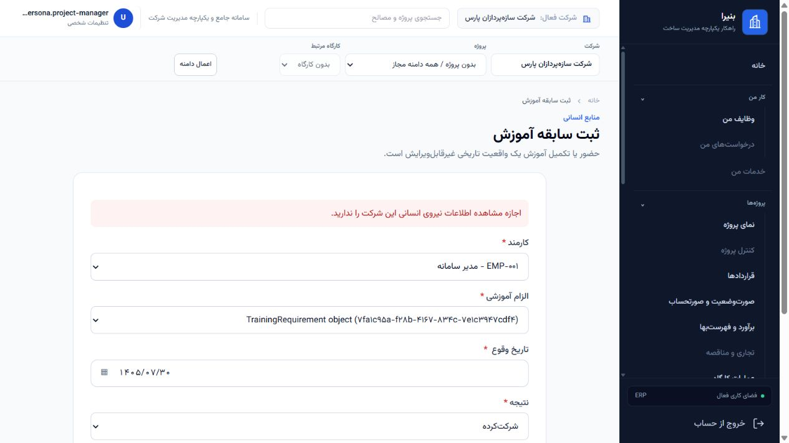

# UIUX-F-128 bounded remediation

Date: 2026-10-22 (Asia/Tehran). Development / Non-Production only.

Finding: **UIUX-F-128**, independent SP031-derived Employee Training Record
`TrainingRequirement` selector defect. Closure status: **RUNTIME_VERIFIED_RESOLVED**.
This report does not reopen the F111 pattern family.

## Authority and baseline

The Human authorized implementation and complete runtime closure of this finding
only. The canonical diagnosis and identifiers remain in
[UIUX_SP031_RUNTIME_CONFIRMATION_REPORT.md](UIUX_SP031_RUNTIME_CONFIRMATION_REPORT.md)
and [UIUX_FINDINGS_REGISTER.yaml](UIUX_FINDINGS_REGISTER.yaml).

Branch `main`; HEAD and upstream
`43ac319c6e73e48ca9626461b73987922c498ec3`. The pre-existing dirty product files,
F111 BATCH-01..09 evidence, protected documents and other work are retained.
[ENTRY_BASELINE.json](sp031_f128_remediation_evidence/ENTRY_BASELINE.json)
records 9,429 existing file fingerprints and the exact touch set.
[ENTRY_BASELINE_RECOVERY.json](sp031_f128_remediation_evidence/ENTRY_BASELINE_RECOVERY.json)
explains that the two entry-source copies were recovered by reversing only the
local edit in evidence after the broad capture finished late. Their SHA-256 values
match the pre-existing SP031 confirmation fingerprints exactly. Product files were
never swapped or restored for baseline validation.

Runtime guard: `config.settings.development`, DEBUG enabled, local PostgreSQL
`construction_erp`; zero pending migrations. The runtime used a dedicated loopback
server on port 8014 with `--noreload`. Tests use the verified, fully migrated,
empty disposable `test_bonira_uiux_batch09` database, temporary document storage
and the canonical schema. Slow/interrupted fresh test preparation was not counted
as PASS; [TEST_DATABASE_REUSE.json](sp031_f128_remediation_evidence/TEST_DATABASE_REUSE.json)
records all 434 canonical migrations and zero tenant rows before reuse.
No Development schema/data migration was executed.

## Root cause and bounded fix

`EmployeeTrainingRecordForm` previously selected all active, unarchived tenant
requirements. Its HTTP view did not supply membership, so Project-limited and
Site-only actors saw requirements outside their Project grants.

- The view now supplies the existing canonical active membership.
- Only the form constructor and necessary imports change. Invalid, missing,
  inactive, foreign-tenant or incapable membership fails closed.
- Project-bound requirements are intersected with existing `scope_queryset`
  using `project_id`. Site-only grants do not expand to their parent Project.
- Projectless catalogue entries retain their prior tenant visibility for a valid
  scoped capability holder. Employee master visibility, requirement lifecycle
  predicates, model ordering, fields and labels remain unchanged.
- `record_employee_training`, global authorization helpers, all other Workforce
  views/forms, models, templates, workflows and migrations are unchanged. Its
  stricter organization-level write gate still denies limited actors even when
  B or a projectless requirement is selectable. No new write authority is implied.

[SOURCE_BOUNDARY.json](sp031_f128_remediation_evidence/SOURCE_BOUNDARY.json)
verifies AST equality outside the constructor, first view form assignment and
three imports, plus preservation of all other pre-existing files. Migration: **NO**.

## Validation

Focused validation: **19 tests and 37 subtests PASS**. See
[focused.xml](sp031_f128_remediation_evidence/focused.xml) and
[focused.txt](sp031_f128_remediation_evidence/focused.txt).
The matrix covers initial/bound forms, same-tenant and cross-tenant IDs,
Project/Site grants, invalid redisplay, direct service denials, required fields,
membership/capability/grant lifecycle, inactive/archived catalogue records,
authorized submissions, audit creation and immutable history.

Relevant regression: **37 tests and 41 subtests PASS; 30 unchanged baseline
failures; zero new regressions**. The same 67 tests ran against current sources
and the exact, fingerprint-verified dirty-entry forms/views using an import loader.
All test identities, outcomes and failure messages match. The failures are in
legacy Workforce fixtures that create legacy memberships without the current
canonical role/scope assignments. Services deny those requests, or HTTP returns
403 before the affected training form. No failing test requires this remediation
to be reverted, and no permission check was weakened to make legacy tests pass.
This is **BASELINE TEST DEBT**, not a full Workforce regression PASS.

Regression includes `apps/workforce/tests.py`, the three P7 foundation tests and
the existing 22-test TrainingRequirement Project-selector matrix from BATCH-08.
Evidence: [regression.xml](sp031_f128_remediation_evidence/regression.xml),
[baseline_regression.xml](sp031_f128_remediation_evidence/baseline_regression.xml),
[REGRESSION_ATTRIBUTION.json](sp031_f128_remediation_evidence/REGRESSION_ATTRIBUTION.json).

Django check, Ruff on both changed product files and the new test, new-test
formatting, migration drift, current Development migration currency, YAML,
source-boundary and whitespace checks: **PASS**.
[CHECKS.json](sp031_f128_remediation_evidence/CHECKS.json) retains commands and
outputs. No product-wide suite or full-file formatting is claimed.

## Runtime fixtures and actors

[FIXTURES.json](sp031_f128_remediation_evidence/FIXTURES.json) records reuse of the
six canonical `SP031-RUNTIME-A/B/C/D/X/O` requirements, existing synthetic EMP-001,
Projects/site and three existing personas. No fixture or authority write was needed.

| Persona | Canonical role/scope | Requirement choices |
| --- | --- | --- |
| uiux.persona.project-manager | project_manager; Projects A/B | A/B/O |
| uiux.reference.batch03.site-only | operations_manager; one Site of A | O only; no Project-bound choices |
| uiux.persona.tenant-admin | tenant_admin; organization | A/B/C/D/O |

X belongs to `demo-construction-02`; all other controls belong to
`demo-construction-01`. O is projectless. Existing optional catalogue semantics
are preserved; no new visibility policy for tenant masters is introduced.

## HTTP and browser security retest

Actual authenticated, CSRF-protected HTTP: **40/40 PASS**.
[HTTP.json](sp031_f128_remediation_evidence/HTTP.json) and
[HTTP_SUMMARY.json](sp031_f128_remediation_evidence/HTTP_SUMMARY.json)
contain per-request options, errors, response hashes and positive record/audit IDs.
Numbered HTML captures omit CSRF inputs and unrelated Employee labels.

- Authorized choices remain visible with the expected exact sets above.
- Same-tenant unauthorized C/D and cross-tenant X are absent on initial GET,
  forged query IDs, all four required-field errors and denied POST redisplay.
- Site-only has no parent-A or other Project-bound Requirement option.
- Manipulated C/D/X/malformed IDs are rejected by field validation. Limited B/O
  and site-only O retain the existing service denial; no unauthorized record or
  success audit is created.
- Organization-authorized valid B and O POSTs each create exactly one immutable
  training record and one success audit and redirect to the correct Employee.

Independent direct-service controls: **18 expected outcomes PASS**, with
organization positives rolled back. See
[DIRECT_SERVICE.json](sp031_f128_remediation_evidence/DIRECT_SERVICE.json).

Browser: **seven observations**, including **three real server POSTs**: limited B
denied redisplay, Site-only O denied redisplay, and organization-authorized A
success. The invalid-date interaction was stopped by the existing client date
validator and is explicitly not counted as a server POST; HTTP/tests separately
prove server invalid redisplay. C/D/X absence is verified from actual option
values, with labels retained as rendered.
[BROWSER.json](sp031_f128_remediation_evidence/BROWSER.json).

Additional captures: [limited GET](sp031_f128_remediation_evidence/browser_limited_get.png),
[Site-only GET](sp031_f128_remediation_evidence/browser_site_get.png),
[Site-only redisplay](sp031_f128_remediation_evidence/browser_site_redisplay.png),
[organization GET](sp031_f128_remediation_evidence/browser_authorized_get.png).
The temporary browser personas were logged out and the temporary tab closed.
The positive submission's success message and training row are retained in the
browser ledger; the profile screenshot was excluded because it also contained an
unrelated pre-existing profile photo.

## Runtime integrity

[RUNTIME_BEFORE.json](sp031_f128_remediation_evidence/RUNTIME_BEFORE.json),
[RUNTIME_AFTER.json](sp031_f128_remediation_evidence/RUNTIME_AFTER.json) and
[INTEGRITY.json](sp031_f128_remediation_evidence/INTEGRITY.json) cover **519 tables**.

Exactly three authorized synthetic records and their three success audits persist:
HTTP B/O and browser A, all by the existing tenant-admin persona for EMP-001.
Sessions are the only other table delta. All pre-existing business rows, requirements,
roles, permissions and scope grants remain unchanged. Login timestamps are explicitly
excluded from business fingerprints. Unauthorized records/audits: **zero**.
Temporary authority: **none**; no revocation required. Authorized immutable history
and append-only audits are retained rather than deleted after testing.

## Governance and stop boundary

The register records only UIUX-F-128 as `RUNTIME_VERIFIED_RESOLVED`, with
`finding_status: RESOLVED`. The original SP031 diagnosis remains
`AFFECTED_CONFIRMED` as historical confirmation; the appended
`sp031_finding_remediation` records the later resolved remediation state.
[VERIFICATION.json](sp031_f128_remediation_evidence/VERIFICATION.json) gates closure
on focused tests, exact baseline attribution, checks and runtime evidence. All
required remediation gates pass; the 30 pre-existing Workforce failures remain
explicitly attributed and outside this bounded fix.

F111 remains `F111_PATTERN_FAMILY_CLOSED`; all 127 earlier finding objects and
BATCH-01..09 history remain unchanged. Wave C: `NOT_STARTED`. CEP-078/079,
Production actions, Human Sign-off and Production Certification: not executed.
Git add/commit/push/merge: not executed. No roles, permissions, global authorization
semantics, domain/workflow rules or unrelated Workforce paths were changed.

[PROCESS_CLOSEOUT.json](sp031_f128_remediation_evidence/PROCESS_CLOSEOUT.json)
records the dedicated server/browser cleanup. The original SP031 confirmation
report/evidence, F111-family findings, closure report and BATCH-01..09 evidence are
preserved. **UIUX-F-128 bounded runtime closure complete. STOP.**
