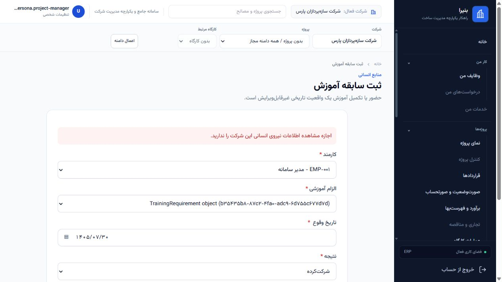

# SP031 runtime confirmation

Date: 2026-10-22 (Asia/Tehran). Development / Non-Production only.

**SP031 final decision: `AFFECTED_CONFIRMED`. New independent finding: `UIUX-F-128`.**

The Employee Training Record `TrainingRequirement` selector exposes same-tenant,
out-of-scope requirement UUIDs. Initial GET, required-field redisplay and denied
POST redisplay retain the unauthorized choices. Cross-tenant exclusion and write
denial hold. No unauthorized Employee Training Record or success audit was created.
No remediation was performed.

## Baseline and authority

- Repository: `E:\Construction_Company_Solution`; branch `main`; HEAD and upstream
  both `43ac319c6e73e48ca9626461b73987922c498ec3` throughout.
- Explicit Human authorization: this session's SP031-only runtime confirmation,
  including minimum synthetic Development fixtures through existing services.
- Entry state: SP031 `NEEDS_RUNTIME_CONFIRMATION`; F111 family
  `F111_PATTERN_FAMILY_CLOSED`; Wave C `NOT_STARTED`.
- The pre-existing dirty tree includes 20 product files, prior UIUX evidence/tests,
  graphify output and protected documents. They were preserved.
- `config.settings.development`, DEBUG enabled; Django PostgreSQL database
  `construction_erp` at `127.0.0.1:5432`; zero pending migrations. A dedicated
  loopback server ran on port 8013 with `--noreload`; it had already exited when
  closeout verified that the PID and port were no longer active.
- Grounding, environment, dirty-entry state and file fingerprints:
  [GROUNDING.json](sp031_runtime_evidence/GROUNDING.json) and
  [FILES_BEFORE.json](sp031_runtime_evidence/FILES_BEFORE.json).

The governing [Workforce foundation contract](../../architecture/P7_S01_S05_WORKFORCE_FOUNDATION_IMPLEMENTATION.md)
defines tenant/project/position-scoped requirements and applicable Project scope
for project-bound training actions. `Agents.md` requires tenant/object scope for
querysets and forms. The existing service checks organization-level Workforce
authority first, then the requirement's Project. The HTTP capability decorator
accepts limited grants, while `EmployeeTrainingRecordForm` only filters requirements
by tenant, active status and archival status. No membership reaches this form.

This confirmation uses Project-bound C/D records to prove the scope defect. It
does not impose a new Project restriction on tenant Employee/Skill/Position masters,
or decide the visibility semantics of a projectless training catalogue. No canonical
CEP package is executed or changed.

## Minimum fixture preparation

At entry the runtime database contained zero TrainingRequirements. Six were created
atomically with `create_training_requirement`, using existing tenant owners with
canonical permissions. Each service invocation retained its preparation audit.

| Fixture | Tenant | Project | Purpose |
| --- | --- | --- | --- |
| SP031-RUNTIME-A | demo-construction-01 | PRJ-01-01 | Project-granted positive reference; site-only parent control |
| SP031-RUNTIME-B | demo-construction-01 | PRJ-01-02 | Second authorized Project reference |
| SP031-RUNTIME-C | demo-construction-01 | PRJ-01-03 | Same-tenant unauthorized control |
| SP031-RUNTIME-D | demo-construction-01 | PRJ-01-04 | Independent unauthorized sibling control |
| SP031-RUNTIME-X | demo-construction-02 | PRJ-02-01 | Cross-tenant control |
| SP031-RUNTIME-O | demo-construction-01 | none | Optional Project/catalogue compatibility control |

Existing Projects, site, Employees, memberships, role assignments and scope grants
were reused. No workforce identity, role, permission, grant or workflow was created
or broadened. HTTP/direct controls reused an existing Employee; browser POSTs also
used existing synthetic `EMP-001` for the saved captures. Fixture UUIDs and creators
are in [FIXTURES.json](sp031_runtime_evidence/FIXTURES.json).

Fixtures and their six audit events remain available for later bounded review.
No historical training fact or audit event was deleted. Temporary authority: none.

## Actors and scopes

All three are existing, authenticated, active tenant members with
`workforce_qualifications.manage`; none is staff or superuser.

| Actor | Existing role | Scope | Canonical permission evidence |
| --- | --- | --- | --- |
| uiux.persona.project-manager | project_manager | Projects A/B | A/B Project permission true; C/D/X false; organization permission false |
| uiux.persona.tenant-admin | tenant_admin | Organization | A/B/C/D and organization permission true; X false |
| uiux.reference.batch03.site-only | operations_manager | One Site of A only | No Project-only or organization action authority; no implicit parent expansion |

TrainingRequirement has no Site field. The site-only actor cannot acquire
Project-wide action authority through its parent Project. The existing service
also requires organization authority before its Project check, so limited actors
are denied even for A/B. That stricter baseline is recorded without changing it.
Authority values and fingerprints are retained in
[RUNTIME_BEFORE.json](sp031_runtime_evidence/RUNTIME_BEFORE.json) and
[INTEGRITY.json](sp031_runtime_evidence/INTEGRITY.json).

## HTTP and automated evidence

Route: `/workforce/foundation/training-records/create/`. All HTTP observations use
real login, server sessions and real CSRF tokens against the dedicated server.
The completed matrix contains **22 observations**:

- Project-limited and site-only actors: each initial GET, required-field invalid
  POST, three forced Requirement query IDs, and five complete manipulated POSTs.
- Organization actor: authorized GET and required-field invalid POST.

| Required control | Observed result |
| --- | --- |
| Authorized choices | PASS: organization actor sees A/B/C/D/O; Project actor sees its A/B choices |
| Same-tenant unauthorized absence | **FAIL:** Project actor also sees C/D UUIDs; site-only actor sees all A/B/C/D Project-bound UUIDs |
| Applicable Project/Site scope in selector | **FAIL:** all three actors receive the same A/B/C/D/O requirement choices |
| Cross-tenant absence | PASS: X never appears as an option, resolved label or metadata |
| Manipulated unauthorized Requirement POST | PASS: valid same-tenant controls reach service denial; X fails ModelChoice validation |
| Invalid/denied redisplay protects metadata | **FAIL:** C/D UUIDs remain in Project actor choices; site-only retains Project-bound choices |
| Unauthorized training creation/success audit | PASS: zero persisted delta for every request |

Actual labels are `TrainingRequirement object (<UUID>)`. The confirmed disclosure
is the object identifier and generic model label; requirement name, code,
description, related Project metadata and full content disclosure are not claimed.
Examples exposed to the Project-limited actor:

- C: `b35435b8-87c2-4fa0-adc9-6d755c677d7d`.
- D: `ab96f57f-a801-4992-b743-3e6980e616b9`.

All manipulated POSTs return HTTP 200 **with validation/permission errors**, not
success. There is no successful redirect or business creation. Limited controls
cover B/C/D/X/O; site-only controls cover A/C/D/X/O. Dates use valid Jalali
`1405/07/30`; same-tenant POSTs reach the existing service's permission denial.

Independent direct-service assertions cover all six requirements for each actor:
**18 expected outcomes**, including five organization-authorized positive calls
inside rollback-only transactions and cross-tenant/limited denials. The positive
records and their audits are rolled back; no runtime success audit persists.

Evidence: [HTTP.json](sp031_runtime_evidence/HTTP.json),
[HTTP_SUMMARY.json](sp031_runtime_evidence/HTTP_SUMMARY.json),
[DIRECT_SERVICE.json](sp031_runtime_evidence/DIRECT_SERVICE.json), and numbered
`http_01.html` through `http_22.html`. Captures omit CSRF inputs and unrelated
Employee option labels; original response hashes identify the received responses.

An initial harness assertion treated the caller-supplied X UUID echoed in a
navigation `next` URL as resolved metadata. The assertion was corrected to exclude
that navigation echo, then the full matrix completed. X remained absent from the
actual selector throughout. This was a harness correction, not a product fix.

## Browser evidence

The in-app browser used the same loopback server and ordinary credential login.
Three personas produced **five observations and three real server POSTs**:

1. Project-limited GET displays A/B/C/D/O choices, excluding X.
2. Two complete C POSTs are denied; the second uses synthetic EMP-001. C remains
   selected and D remains available on denied redisplay.
3. Site-only GET displays the same Project-bound choices, excluding X.
4. Site-only parent-A POST is denied; the choices remain on redisplay.
5. Organization-authorized GET displays A/B/C/D/O, excluding X.

Browser option values, selected values and error text:
[BROWSER.json](sp031_runtime_evidence/BROWSER.json).

Additional captures: [limited GET](sp031_runtime_evidence/browser_limited_get.png),
[site GET](sp031_runtime_evidence/browser_site_get.png),
[site POST denial](sp031_runtime_evidence/browser_site_post.png), and
[organization positive](sp031_runtime_evidence/browser_authorized_get.png).
All temporary browser personas were logged out and the temporary tab closed.

## Before/after runtime integrity

[PREPARATION_BEFORE.json](sp031_runtime_evidence/PREPARATION_BEFORE.json),
[RUNTIME_BEFORE.json](sp031_runtime_evidence/RUNTIME_BEFORE.json),
[RUNTIME_AFTER.json](sp031_runtime_evidence/RUNTIME_AFTER.json) and
[INTEGRITY.json](sp031_runtime_evidence/INTEGRITY.json) compare **519 model tables**.

- Preparation delta: exactly six TrainingRequirements and six preparation audits.
- All pre-existing business rows remain unchanged through preparation and runtime.
- Runtime delta: sessions only; `User.last_login` is explicitly excluded from
  business-row fingerprints because ordinary login updates it.
- EmployeeTrainingRecord delta: zero; runtime success-audit delta: zero.
- Role, permission and scope authority fingerprints match before/after:
  `c384b152cd3dba8861227ba5b432f309cd00c5d142248bab2ddd76db27a7bbf8`.
- No temporary grants existed or required revocation. No migrations were applied.

Commands: `.venv\Scripts\python.exe docs/governance/uiux/sp031_runtime_evidence/runtime.py`
with `prepare`, `http`, `direct`, and `after`; governance preservation verification
with `py -3.11 docs/governance/uiux/sp031_runtime_evidence/closeout.py`. The existing
system PyYAML validates the register; no dependency was installed. Runtime database
checks passed. Closeout verifies YAML, 127 unchanged prior finding objects, existing
file hashes, unchanged HEAD and evidence completeness. No product regression suite
is claimed; product code was not changed.

## Governance update and safety boundary

[UIUX_FINDINGS_REGISTER.yaml](UIUX_FINDINGS_REGISTER.yaml) now records current
`sp031_runtime_confirmation.status: AFFECTED_CONFIRMED` and independent open
`UIUX-F-128`. Total finding count is 128; MEDIUM count is 46. All 127 prior finding
objects and their historical evidence remain unchanged. Prior sweep and family
closure statements about SP031 are retained as dated history; this new SP031 entry
records the later runtime decision.

[CLOSEOUT_VERIFICATION.json](sp031_runtime_evidence/CLOSEOUT_VERIFICATION.json)
proves existing product/governance/history preservation except the authorized
findings-register addition. New evidence and this report are the only other
intended file writes. [PROCESS_CLOSEOUT.json](sp031_runtime_evidence/PROCESS_CLOSEOUT.json)
records that the session-owned server was no longer running at closeout.

F111 family remains `F111_PATTERN_FAMILY_CLOSED`. Its findings are untouched.
Wave C remains `NOT_STARTED`. CEP-078/079: not executed. Product code,
authorization semantics, canonical contracts, roles/permissions, schema and
workflows: unchanged. Production action, Human Sign-off and Production
Certification: not executed. Git add/commit/push/merge: not executed. Remediation
of UIUX-F-128: not started; separate bounded authorization is required.

**SP031-only runtime confirmation complete. STOP.**
