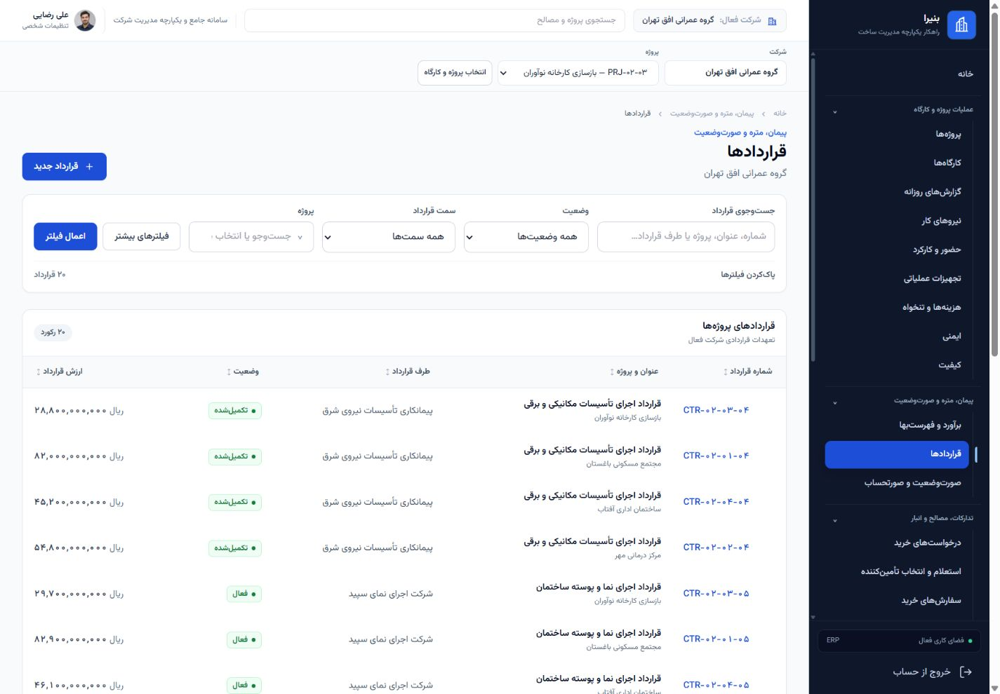
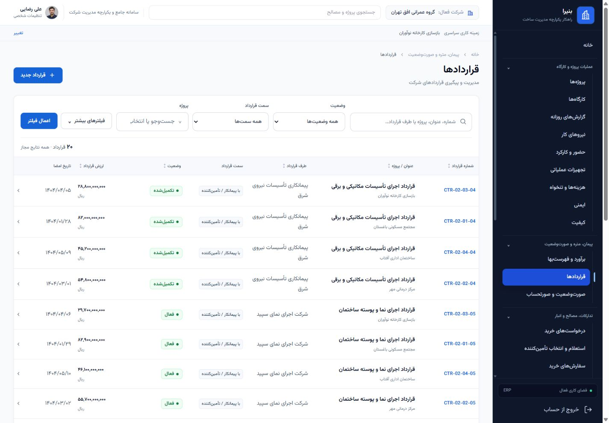
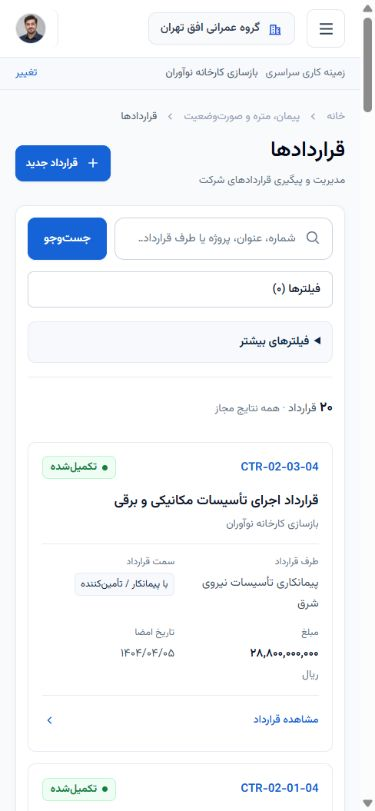

# Reference Contracts List — completion evidence

Date: 2026-11-01 (Asia/Tehran). Explicit bounded Product Owner request; Contracts
adoption only. This is not a CEP queue execution or a lifecycle/Gate update.

## Repository and authority

- Branch: `main`; start/end HEAD: `5b760e853b329e2b03415da7b046641359db6a62`.
- `origin/main` matched HEAD at grounding; initial working tree was clean.
- Guidance: `Agents.md`, generic Execution Policy, `docs/ui-guidelines.md`,
  `design/BONIRA_UI_COLOR_SYSTEM.md`, current Contract view/filter/read behavior.
- Reference: latest corrected generated Contracts preview in Product Owner chat
  `6ae1d3af-8148-83ea-81b5-a8e956b111b4`, immediately before the implementation
  prompt. The preview was opened and visually inspected in real Chrome; see
  [reference-preview.jpg](reference-preview.jpg).
- No models, migrations, services, calculations, permissions, scope, direction
  semantics, workflows, Product Surface policy or dependencies changed.
- No production action, sign-off, certification, Git branch/worktree creation,
  `git add`, commit, push or merge. Changes remain uncommitted on local `main`.

## Actual touch set and delivered behavior

- `templates/contracts/list.html`: compact header, project-local scope notice,
  one filter workspace, eight table columns, existing detail actions and footer.
- `templates/contracts/side_label.html`: explicit business labels for the existing
  directions and a safe unset label; no raw backend direction values.
- Shared `filter_bar.html`, `list_active_filters.html`,
  `list_result_summary.html`, `list_pagination.html`, `list_working_context.html`.
- `apps/accounts/static/css/erp_reference_list.css`: opt-in canonical BONIRA colors,
  compact controls, responsive semantic table/card rows and LTR identifiers.
- `templates/base.html`: two extension blocks whose original defaults are
  unchanged. Contracts alone overrides global-context and pagination presentation.
- `templates/components/README.md`: component inputs and adoption boundary.
- `apps/contracts/test_reference_list_browser.py`: meaningful browser coverage
  for filtered pagination, title sorting, mobile cards and disclosure controls.
- `output/reference-contract-list/`: screenshots, scenario results and this report.

The existing unified search still covers contract number, title, project,
counterparty name and linked business-party name. Quick filters retain status,
side and removable project; inherited `project_id` hides the project selector.
Existing secondary number, title/project and counterparty text filters remain
available. Number matching remains the existing substring behavior, not a newly
invented exact-match rule. No type, date or amount filtering or export was added
because these have no existing Contract List backend support. No selection/bulk
controls, fabricated totals or inactive column controls were introduced.

The collapsed global working-context control retains the original POST form,
CSRF and options. Its explanatory note distinguishes it from page filtering.
Inherited list context remains independently visible and preserved on apply,
chip removal, clear-all, sorting, pagination and contextual creation.

## Validation

Commands:

```text
.venv/Scripts/python.exe scripts/verification/mvp03_validate.py apps/contracts/test_filter_bar.py apps/contracts/test_filter_bar_browser.py --reuse-db -q
9 passed, 8 subtests passed in 91.61s

.venv/Scripts/python.exe scripts/verification/mvp03_validate.py apps/contracts/test_reference_list_browser.py --reuse-db -q
1 passed in 38.19s (final run)

.venv/Scripts/python.exe manage.py check
System check identified no issues (0 silenced).

.venv/Scripts/python.exe -m ruff check apps/contracts/test_reference_list_browser.py
All checks passed!

.venv/Scripts/python.exe -m ruff format --check apps/contracts/test_reference_list_browser.py
1 file already formatted

git diff --check
PASS
```

Total: **10 tests, 8 subtests; 20 real Chrome scenarios**. Test records were created
only in the dedicated PostgreSQL test database `test_bonira_mvp03_20261029`.
The existing filter suite's newly generated changed artifacts were copied into
`filter-regression/`, and its tracked historical evidence was restored from HEAD
with the repository's working-tree line endings. The unchanged deterministic
denied-access result is included too.
Graphify's own query stamp was restored; no graph changes belong to this task.

One prematurely started second test invocation was stopped before reporting an
outcome; the Reference test was then run alone and passed. The last run above is
the final result. No pass is claimed for the interrupted invocation.

| Required behavior | Evidence/result |
| --- | --- |
| General and project-scoped list | FB-01, FB-07/08/11; interactive Chrome, 20 general vs 5 scoped records |
| Search | Functional per-source search cases; FB-02/03; interactive combined search |
| Status and both contract sides | FB-02, FB-05/06; localized row labels and chips |
| Project filter and remote options | FB-15/16; tenant/object-scope functional cases |
| Advanced open, close, apply and restored state | FB-12/14; REF-advanced-open-close-desktop |
| Active chips, individual removal, clear-all | FB-02/03/04/08/10/11/16; interactive Chrome |
| Pagination preserving filters | REF-pagination-and-sort-desktop; REF-scoped-pagination-mobile, 31 filtered records over 2 pages |
| Existing sorting | Server-rendered existing sort helper; title-sort navigation retains filters and resets page |
| Desktop 1440 / mobile 390 | Chrome viewport assertions and screenshots; cards verified via computed layout |
| RTL and LTR identity | Persian RTL document, `<bdi dir="ltr">` canonical contract numbers; numeric/font inspection |
| No page overflow | Document scroll width equals client width in every successful scenario; mobile row is a grid within the viewport |
| No technical leakage | Visible-text/option checks; no raw direction, UUID labels, model strings, or traceback |
| No 404/500 on validated list navigation | 19 expected HTTP 200 documents, one expected permission-denied HTTP 403 |
| Row action | Interactive Chrome followed existing detail link and returned to list without traceback |

Raw scenario details: [VALIDATION.json](VALIDATION.json), `filter-regression/batch-*.json`,
`browser/batch-REF-pagination-and-sort-desktop.json`. Broader ERP regression is not
claimed. Unrelated Chrome extension connection errors were observed in the user's
browser; the isolated Chrome probe is extension-free. The starting-HEAD screenshot
server also logged an existing `/favicon.ico` 404. This is baseline shell-asset
debt, outside this list change; no product/list navigation returned 404 or 500.

## Visual review

Before screenshots render the actual starting HEAD templates on a temporary local
port 8001 with the same existing development data and browser session. The helper
`baseline-server.py` reads those templates from Git; it makes no product mutation.
That temporary server was stopped. The shared development server was preserved.
Before/after captures use matching 1440×1000 desktop and 390×844 mobile viewports.
Temporary browser viewport overrides were reset after inspection.

Reviewed directly in Chrome: general desktop, active filters, inherited project,
expanded advanced filters and mobile cards. Compared with the approved preview:
compact title/action hierarchy, secondary working context, unified search toolbar,
separate advanced panel, visible removable chips/result count and restrained
business table hierarchy. Search-icon spacing and mobile label duplication were
corrected during visual review; the advanced panel was reduced to one compact row
on desktop. Shared BONIRA badges and the existing application shell remain.

The preview's unsupported export, bulk action, aggregate total and extra filters
are omitted under the explicit user constraints. Existing detail navigation uses
a clear row action rather than a decorative menu with no supported extra actions.
Visual conformance is an agent assessment of the approved direction and the
authorized implementation, not Product Owner acceptance or pixel identity.

| Before | After |
| --- | --- |
|  |  |
|  |  |

Additional captures: [active filters](after-active-filters.jpg),
[project scoped](after-project-desktop.jpg),
[expanded advanced filters](after-advanced-desktop.jpg).

REFERENCE CONTRACT LIST FUNCTIONAL: PASS  
REFERENCE CONTRACT LIST BROWSER: PASS  
REFERENCE VISUAL CONFORMANCE: PASS  
PRODUCT OWNER VISUAL ACCEPTANCE: PENDING
